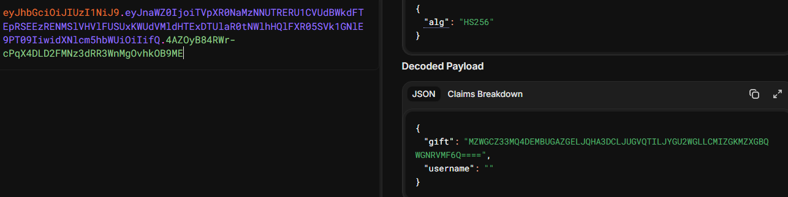

### JWT

#### 一、思路

题目名提示 JWT（JSON Web Token）

```
  html源码提示 int(time.time()) - int(password) < 5
  控制台用 Date.now()/1000 填密码, 还是 miss 
  本地时钟与服务器不同
  fetch / 拿服务器 Date 头反推时间戳, 填密码框提交
  Login success，Cookie 发现 token
  解码 JWT
  payload.gift 是 base32 解码得 flag
```

#### 二、分析

##### 2.1 看页面反应
> The moment you've been waiting for is finally here!
> But be careful, the moment is fleeting.


用户名试 `admin`，密码随便，页面跳回登录框，提示
```
>>> You missed the moment! <<<
```

##### 2.2 F12 看源码看注释

在密码框下面，有一行注释

```html
<input type="password" name="password" id="password" placeholder="The moment now is..." />
<!-- maybe... int(time.time()) - int(password) < 5 -->
```

提示了服务端校验逻辑

##### 2.3 读懂校验逻辑

第一个 `time` 是 Python 标准库，提供时间相关函数
第二个 `time.time()` 返回当前的 Unix 时间戳,秒
`int(time.time()) - int(password) < 5` 
服务端把用户提交的密码强制转成整数，和服务器当前时间戳做差，差值要小于 5

密码应该填当前的 Unix 秒级时间戳，有大约 5 秒的容错，用户名没有限制

##### 2.4 尝试用本地时间戳

浏览器控制台里没有直接返回秒级时间戳的原生函数，`Date.now()` 拿到的是毫秒，除以 1000 再用 `Math.floor` 取整。在 Console 里执行：

```javascript
document.getElementById("password").value = Math.floor(Date.now() / 1000);
document.querySelector("form").submit();
```

提示还是 `You missed the moment!`

##### 2.5 用服务器时间戳登录

先 fetch 一次首页，从响应头 `Date: Fri, 02 Oct 2026 01:10:53 GMT` 里取服务器自己的时间，转成 Unix 时间戳填进密码框再提交
提前把开发者工具Network的`保留日志`打开

```javascript
fetch('/', {cache: 'no-store'}).then(r => {
  const ts = Math.floor(new Date(r.headers.get('Date')).getTime() / 1000);
  document.getElementById("password").value = ts;
  document.querySelector("form").submit();
  });
```
页面出现提示
```
>>> Login success! <<<
```

Network里找 `login` 的响应，在Cookies有 `token`


把JWT在工具解码


`gift` 里面是base32的编码
解出一段 UUID 格式字符串

#### 三、最终 Flag

```
flag{d820402b-0861-45a4-855c-bb2e370ac65a}
```
不同时间段会生成不同的 UUID,以自己得到的cookie为准

[JWT解码工具](https://www.jwt.io/)
