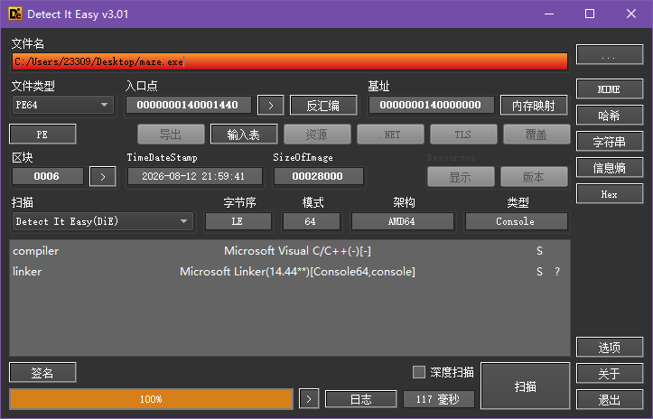
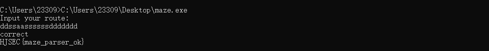

### EZMAZE

#### 一、思路

```
  DIE 查壳：64 位 Console 程序，无壳
  IDA64 打开，F5 看 main 伪代码
  输入长度必须为 19，起点 (1,1)，终点 (8,9)
  wasd 控制移动，每走一步用位运算判断是否撞墙
  地图数据存在 byte_140017350 前 16 字节，XOR 0xA7 按位取出墙
  还原 11×11 迷宫，走出路径 ddssaassssssddddddd
  用路径字符串按 ROR7 迭代算出单字节密钥 v12
  v12 ^ i ^ 密文[i+16] 逐字节解出 flag
```

#### 二、分析

##### 2.1 DIE 查壳

用 DIE 打开 `maze.exe`

文件类型：PE64，64 位 Windows 可执行程序
Console 控制台程序
无壳，不需要脱壳



##### 2.2 IDA 反编译

用 IDA64 打开，找到 main 函数，按 F5 看 C 伪代码

```c
int __cdecl main(int argc, const char **argv, const char **envp)
{
  char Str[128];
  sub_1400049B8("Input your route:", argv, envp);
  if ( (unsigned int)sub_140001190("%127s", Str) == 1 )
  {
    v5 = 1;   // x 坐标
    v6 = 1;   // y 坐标，起点 (1,1)
    if ( strlen(Str) == 19 )
    {
      // wasd 移动逻辑，逐字符处理
      while ( 1 )
      {
        switch ( v7 )
        {
          case 'a': --v5; --v9; break;   // 左
          case 'd': ++v5; ++v9; break;   // 右
          case 's': ++v6; v4++; break;   // 下
          case 'w': --v6; v4--; break;   // 上
          default: goto LABEL_25;        // 非法字符直接 wrong
        }
        if ( v9 > 0xA ) break;           // 越界判断
        if ( v4 > 0xA ) break;

        // 取地图位：byte_140017350[(x+11*y)>>3] ^ 0xA7 >> ((x+11*y)&7) & 1
        // 取出第 (idx//8) 个字节和 0xA7 异或解密 → 右移 (idx%8) 位 → 看最低位是 0 还是 1
        v3 = byte_140017350[(v5 + 11*v6) >> 3];
        LOBYTE(v3) = (v3 ^ 0xA7) >> ((v5 + 11*v6) & 7);
        if ( (v3 & 1) != 0 ) break;     // LOBYTE(v3)=1 表示撞墙
        // 循环判断,直到字符串末尾
        if ( !*++v8 )
        {
          if ( v5 != 8 || v6 != 9 ) break;  // 终点必须是 (8,9)
          // 校验通过，计算密钥并输出 flag
          ...
        }
      }
    }
  }
LABEL_25:
  sub_1400049B8("wrong", ...);
  return 0;
}
```


| 项目 | 内容 |
|---|---|
| 输入长度 | 必须正好 19 个字符 |
| 起点 | (1, 1) |
| 终点 | (8, 9) |
| 操作 | a / d / s / w（左/右/下/上） |
| 地图判断 | `(map[idx>>3] ^ 0xA7) >> (idx&7) & 1 == 1` 为墙 |

##### 2.3 提取数据还原地图

 `byte_140017350`，前 16 字节是地图数据，后面的是 flag 密文

```python
map_data = [0x58, 0x28, 0x47, 0xD2, 0x84, 0x7D, 0x70, 0x07,
            0xD1, 0x12, 0x2F, 0x52, 0xAA, 0x47, 0x58, 0xA6]
# 前 16 字节：迷宫结构
# 从第 16 字节往后：flag 密文
```

地图判断逻辑：坐标 `(x, y)` 对应 bit 索引 `idx = x + 11*y`
该位为 1 就是墙，为 0 就是通路

```python
def is_wall(x, y):
    idx = x + 11 * y
    byte = map_data[idx >> 3]
    bit = (byte ^ 0xA7) >> (idx & 7) & 1
    return bit == 1
```

写脚本把 11×11 的迷宫打印出来

```
迷宫地图 (S=起点(1,1), E=终点(8,9), #=墙, .=通路):
    0 1 2 3 4 5 6 7 8 9 10
 0  # # # # # # # # # # #
 1  # S . . # . . . . . #
 2  # # # . # . # # # . #
 3  # . . . # . . . # . #
 4  # . # # # # # . # . #
 5  # . . . . . # . # . #
 6  # . # # # . # . # . #
 7  # . # . . . # . . . #
 8  # . # . # # # # # . #
 9  # . . . . . . . E . #
10  # # # # # # # # # # #
```

从 S(1,1) 出发走到 E(8,9)，一共 19 步，路径为

```
ddssaassssssddddddd
```

##### 2.4 路径计算单字节密钥 v12

走到终点后，程序用输入的路径字符串做一轮循环，算出一个单字节密钥 v12

```c
v11 = Str[0];        // 路径第一个字符
v12 = 0x42;          // 初始值 66
do {
    v14 = *++v13;                      // 取下一个字符
    v12 = v11 ^ __ROR1__(v12, 7);      // v12 = 上一个字符 XOR (v12 循环右移 7 位)
    v11 = v14;
} while ( v14 );                        // 直到字符串结束符
```

`__ROR1__(v12, 7)` 表示 8 位循环右移 7 位，等价于循环左移 1 位

```python
def ror7(x):
    x = x & 0xff
    return ((x >> 7) & 1) | ((x << 1) & 0xff)
```

用路径 `ddssaassssssddddddd` 循环计算，得到

```
v12 = 0x75
```

##### 2.5 解出 flag

密文是 `map_data[16]` 往后的 21 字节，输出逻辑

```c
for ( i = 0; i < 0x15; ++i )
    putchar( v12 ^ (unsigned __int8)i ^ byte_140017350[i + 16] );
```

即每个字节：`flag[i] = v12 ^ i ^ 密文[i]`

```python
cipher = [0x3D, 0x3E, 0x24, 0x33, 0x32, 0x0B, 0x1E, 0x13,
          0x07, 0x19, 0x20, 0x0E, 0x18, 0x0A, 0x08, 0x1F,
          0x17, 0x3B, 0x08, 0x0D, 0x1C]

v12 = 0x75
flag = bytes([v12 ^ i ^ cipher[i] for i in range(21)])
print(flag.decode())
```

也可以在 cmd 里运行程序，输入路径验证



#### 三、最终 Flag

```
HJSEC{maze_parser_ok}
```

[解密脚本](附件/script/EZMAZE/flag.py)
[地图绘制脚本](附件/script/EZMAZE/map.py)
