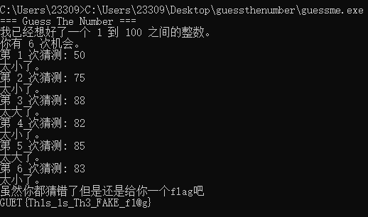
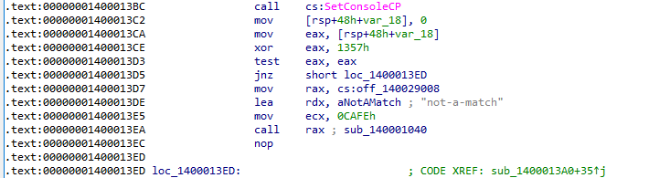

### guessTheNumber

#### 一、思路

```
解压附件得到 guessme.exe，cmd 运行
6 次机会猜 1~100 的数
二分法最多要 7 次，只给 6 次
对错都给出GUET{Th1s_1s_Th3_FAKE_f1@g} 假flag

DIE 查壳：64 位无壳普通 PE，IDA64 打开
Shift+F12 翻字符串，发现一长串 hex 密文和 "H0w_t0_3ncrypt?" 提示
找到一个没有调用的校验函数，里面是 XOR 加密逻辑
flag[i] = enc[i] ^ (反转后的 key)[i % 15]
```

#### 二、分析

##### 2.1 运行得假 flag

解压 `GuessTheNumber.zip` 得到 `guessme.exe`
在 cmd 里运行，避免看不到输出

用完 6 次机会猜错


或者猜对
程序最后都打印同一个假flag `GUET{Th1s_1s_Th3_FAKE_f1@g}`

##### 2.2 DIE 

用 Detect It Easy 打开 `guessme.exe`


| 项目 | 内容 |
|---|---|
| 文件类型 | PE64，Windows Console 程序 |
| 编译器 | Microsoft Visual C/C++ |
| 壳 | 无壳 |

一个普通的 MSVC 编译的 64 位控制台程序，用 IDA64 静态分析

##### 2.3 定位密文和提示

在 IDA 里找到 `start` 函数后 `Shift+F12` 打开字符串窗口
一长串 hex 密文
`7821352D093A1B6C39011A3B2844200C2B024A335231706F5E002D1801174C00021C130E13`
一行提示
`H0w_t0_3ncrypt?`

交叉引用显示这串 hex 密文被 `sub_140001040` 引用
 `H0w_t0_3ncrypt?` 同时被 `sub_140001040` 和 `sub_140001040` 附近的函数引用


进 `sub_140001040`

##### 2.4 校验函数

看 `sub_140001040` 的伪代码

```c
void __fastcall sub_140001040(int a1, __int64 a2)
{
  unsigned __int8 v2;
  unsigned __int64 i;
  char v4[80];

  if ( a1 == 51966 )                      
  {
    if ( a2 && sub_14001C8F0(a2) == 37 )   // 输入长度必须为 37
    {
      for ( i = 0; i < 0x25; ++i )          // 循环 37 次
      {
        // 关键：a2[i] 与 key 按位异或
        v2 = aH0wT03ncrypt[14 - i % 0xF] ^ *(_BYTE *)(i + a2);
        v4[2*i]     = a0123456789abcd[v2 >> 4];   // 转 hex 大写
        v4[2*i + 1] = a0123456789abcd[v2 & 0xF];
      }
      v4[74] = 0;
      // 加密结果与硬编码 hex 密文比较
      if ( sub_14001C870(v4, "7821352D...E13") )
        sub_140001290(",)45<", 5);         // 校验失败
      else
        sub_140001290("\"4.[,25", 7);      // 校验成功
    }
  }
}
```

反汇编里能看到主流程 `call rax ; sub_140001040` 的调用点被一个 `jnz` 跳过，正常不会调用这个函数



 `H0w_t0_3ncrypt?` 这串提示在 `.rdata` 里被这个函数引用


```c
v2 = aH0wT03ncrypt[14 - i % 0xF] ^ a2[i];
```

`aH0wT03ncrypt` 就是字符串 `"H0w_t0_3ncrypt?"`，长度正好 15
`i % 0xF`：对 15 取模，让 key 循环使用；
`14 - i % 0xF`：从末尾往前取字符，等价于把 `"H0w_t0_3ncrypt?"` 反转成 `"?tpyrcn3_0t_woH"` 后再循环使用
然后与第 `i` 个输入字节 `a2[i]` 做异或，再把结果转成 hex，与硬编码密文比较

##### 2.5 解密 flag

加密关系是：

```
enc_hex[i] = ( flag[i] ^ reversed_key[i % 15] ) 的两位 hex
```

XOR反过来

```
flag[i] = enc[i] ^ reversed_key[i % 15]
```

```
enc = bytes.fromhex("7821352D093A1B6C39011A3B2844200C2B024A335231706F5E002D1801174C00021C130E13")
key = "H0w_t0_3ncrypt?"[::-1]   # [::-1]从后往前取，长度 15
```

 Python 脚本：

```python
enc = bytes.fromhex("7821352D093A1B6C39011A3B2844200C2B024A335231706F5E002D1801174C00021C130E13")
key = b"H0w_t0_3ncrypt?"[::-1]         
 # 伪代码里下标是 14 - i % 15，等价于反转后循环取
flag = bytes([enc[i] ^ key[i % 15] for i in range(37)])
print(flag.decode())
```

输出

```bash
GUET{Yu_f1nd_th3_r3A1_C0ntro1_stream}
```
提交正确

#### 三、最终 Flag

```
GUET{Yu_f1nd_th3_r3A1_C0ntro1_stream}
```

[脚本](附件/script/guessTheNumber/solve.py)
