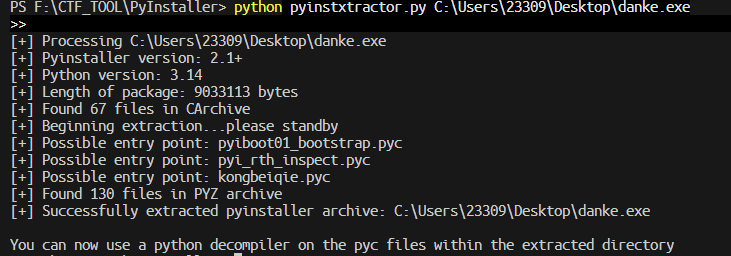

### py交易

#### 一、思路

```
DIE 带 python314.dll  overlay容量大
典型的 PyInstaller 打包
用 pyinstxtractor.py 解包，拿到主脚本字节码 kongbeiqie.pyc
marshal + dis 反汇编，得到 密文encode 置换表table  异或密钥55
校验逻辑：output[i] = chr(ord(flag[table[i]]) ^ 55)
置换 XOR 都是对合运算，按 table 把字符归位，再整体 ^55 还原
```

#### 二、分析

##### 2.1 DIE 查壳

用 DIE 打开
PE32，Windows 控制台程序
Overlay 里面能看到 `python314.dll`  `PYZ.pyz` 
是 PyInstaller 打包出来的 Python 程序

PyInstaller 把 Python 解释器、标准库归档和我们自己脚本的 `.pyc` 字节码
全部附加在 PE 文件最后一节之后（overlay）
脚本本身没有强加密，直接解包就能拿回 `.pyc`

##### 2.2 pyinstxtractor 解包

把经典的 `pyinstxtractor.py` 和 `danke.exe` 放同目录
cmd执行
```bash
python pyinstxtractor.py danke.exe
```



输出几条信息

| 项目 | 内容 |
|---|---|
| Python 版本 | 3.14 |
| 入口脚本 | `kongbeiqie.pyc` |
| 解包目录 | `danke.exe_extracted/` |

最关键的 `kongbeiqie.pyc`，它就是题目主脚本编译后的字节码

##### 2.3 反汇编 kongbeiqie.pyc

`.pyc` 文件开头有 16 字节的头（magic number + flags + 时间戳）
真正的 code object 在后面，用 marshal 序列化存的
Python 自带 `marshal` 和 `dis` 两个标准库就能反汇编

```bash
python -c "import marshal,dis; \
f=open('kongbeiqie.pyc','rb'); \
f.read(16); \
dis.dis(marshal.load(f))"
```

等价的源码

```python
import marshal, dis

f = open('kongbeiqie.pyc', 'rb')
f.read(16)                 # 跳过 16 字节 pyc 头
code = marshal.load(f)      # 反序列化出 code object
dis.dis(code)              # 反汇编成可读指令
```

得到字节码

```text
LOAD_CONST   1 ('YVYh]\x07@h\x0ehRwJVD\x07]s\x03D__ELzhY\x06_TP')
STORE_NAME   1 (encode)        # 目标密文，长度 31

LOAD_CONST   9 ((19,14,10,24,27,6,5,12,11,15,9,26,30,22,16,28,
                 1,13,18,2,17,21,29,4,25,7,8,23,0,3,20))
STORE_NAME   2 (table)          # 31 个元素的置换表

LOAD_SMALL_INT 55
STORE_NAME   3 (XOR_KEY)        # 异或密钥 = 55
```

主流程

```text
flag = input()
if len(flag) != 31:  print('Length Wrong!!')
elif enc(flag) == encode:  print('Wow,you get the right flag!!')
else:                      print('Sorry,Your input is Wrong')
```

`enc` 函数

```text
LOAD_FAST_BORROW   0 (input)
LOAD_GLOBAL        8 (table)
LOAD_FAST_BORROW   2 (i)
BINARY_OP          26 ([])        # input[table[i]]
CALL               1              # ord(...)
LOAD_GLOBAL        10 (XOR_KEY)
BINARY_OP          12 (^)         # ^ 55
CALL               1              # chr(...)
BINARY_OP           0 (+)         # tmp += ...
```

还原加密逻辑

```
output[i] = chr(ord(flag[table[i]]) ^ 55)
```

##### 2.4 还原校验脚本

按反汇编把校验逻辑写成正常Python

```python
encode = 'YVYh]\x07@h\x0ehRwJVD\x07]s\x03D__ELzhY\x06_TP'
table = (19, 14, 10, 24, 27, 6, 5, 12, 11, 15, 9, 26, 30, 22,
         16, 28, 1, 13, 18, 2, 17, 21, 29, 4, 25, 7, 8, 23, 0, 3, 20)
XOR_KEY = 55

def enc(input):
    tmp = ''
    for i in range(len(input)):
        tmp += chr(ord(input[table[i]]) ^ XOR_KEY)
    return tmp
```

##### 2.5 逆运算求解

加密： `encode[i] = flag[table[i]] ^ 55`

```
flag[table[i]] = ord(encode[i]) ^ 55
```

输出的第 `i` 位对应的是原 flag 的第 `table[i]` 位
用一个长度 31 的数组，按 `table` 把每个字符放回原位

```python
encode = 'YVYh]\x07@h\x0ehRwJVD\x07]s\x03D__ELzhY\x06_TP'
table = (19, 14, 10, 24, 27, 6, 5, 12, 11, 15, 9, 26, 30, 22, 16, 28,
         1, 13, 18, 2, 17, 21, 29, 4, 25, 7, 8, 23, 0, 3, 20)
XOR_KEY = 55

ans = [''] * 31
for i in range(31):
    ans[table[i]] = chr(ord(encode[i]) ^ XOR_KEY)   # 按置换表归位
flag = ''.join(ans)

print(flag)
```

输出：

```bash
hjsc{w0_nen9_Da_sh4ngha1_M@j0r}
```

还原出的 flag 再走一遍 `enc()`，结果和 `encode` 完全一致

#### 三、最终 Flag

```
hjsc{w0_nen9_Da_sh4ngha1_M@j0r}
True
```

[脚本](附件/script/py交易/solve.py)
