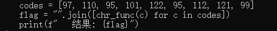

### What_is_pyc

#### 一、思路

```
what_is_pyc.pyc 是 Python 编译后的字节码
uncompyle6 反编译回 .py 源码
前半段是 SSTI 继承链的演示
空字符串  __class__  __mro__  object  __subclasses__  找 chr
真正的 flag 在末尾的 codes 数字数组 ascii
```

#### 二、分析

##### 2.1 识别文件

```bash
file what_is_pyc.pyc
# Python 3.11 bytecode (magic 3394)
```

`.pyc` 是 Python 把 `.py` 编译后的字节码缓存
结构为：4 字节魔数 + 4 字节 flag + 4 字节 mtime + 4 字节源码大小 + marshal 序列化的 code object

##### 2.2 反编译

cnd里用 uncompyle6 还原源码

```bash
uncompyle6 what_is_pyc.pyc
```

反编译出的代码前半段在演示 SSTI 里经典的取 `chr` 链

```python
cls_str = "".__class__                 # str
mro_list = "".__class__.__mro__        # 继承链
obj_class = "".__class__.__mro__[1]    # object
subclasses = obj_class.__subclasses__() # object 的所有子类
# 遍历子类，从 __init__.__globals__['__builtins__'] 里取出 chr
```
 Web 题里 SSTI 绕过的前置知识
只是教学演示

##### 2.3 数字数组即 flag

 flag 是最后一段

```python
codes = [97, 110, 95, 101, 122, 95, 112, 121, 99]
flag = "".join([chr_func(c) for c in codes])
```



ASCII

| 数字 | 97 | 110 | 95 | 101 | 122 | 95 | 112 | 121 | 99 |
|---|---|---|---|---|---|---|---|---|---|
| 字符 | a | n | _ | e | z | _ | p | y | c |

 `an_ez_pyc`

#### 三、最终 Flag

```
flag{an_ez_pyc}
```
