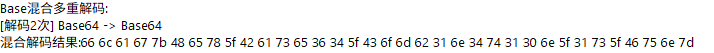
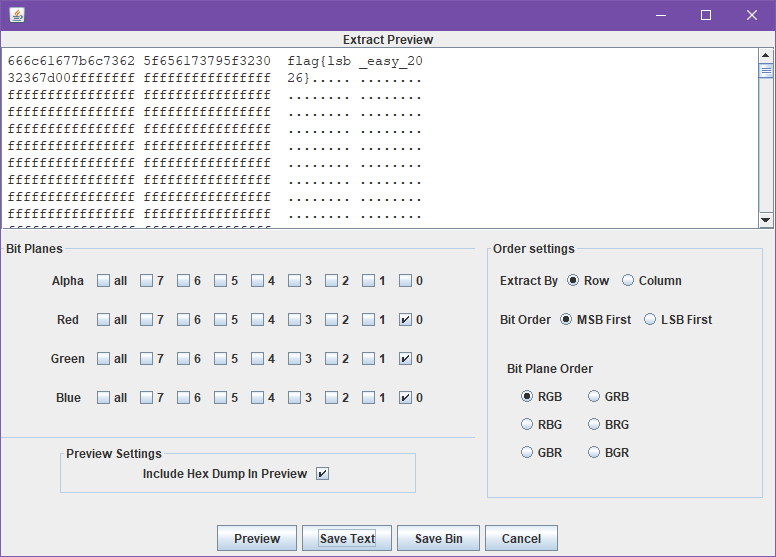
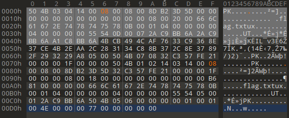
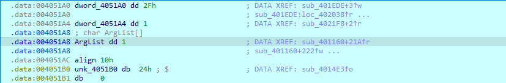
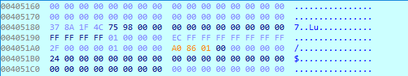
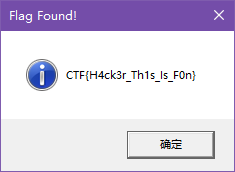
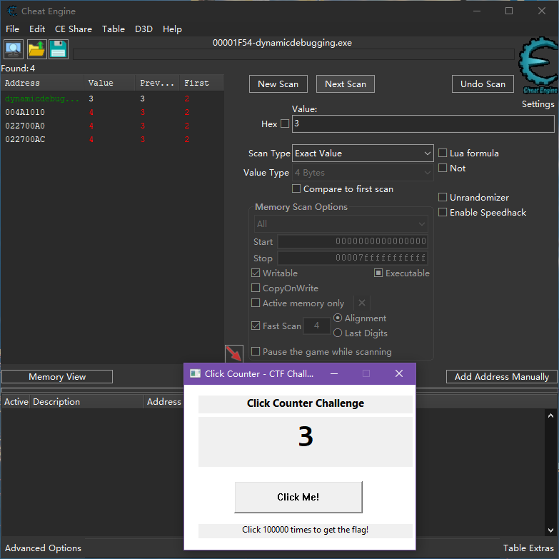
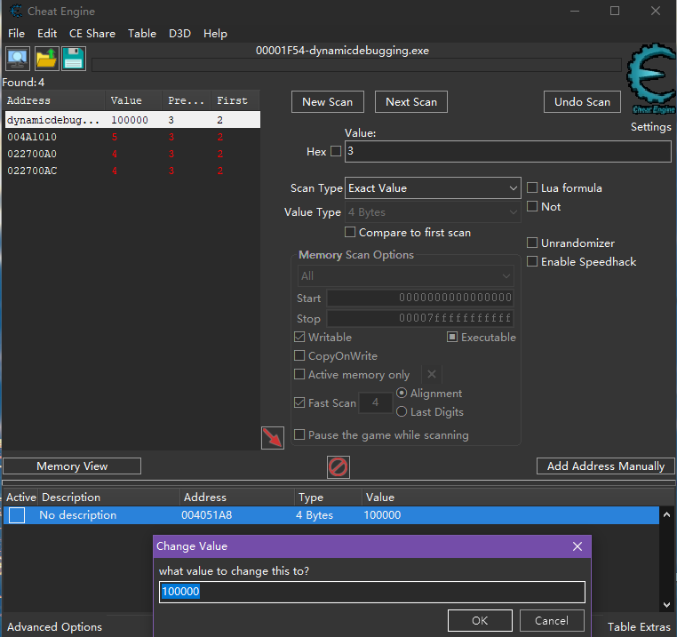
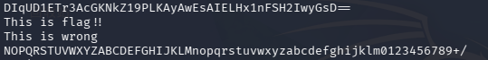

# **安网阁招新考核WP**
#### 姓名：梁丞佑
#### 学号：2600360124
#### QQ号: 2330976026
#### 靶场队伍名称: kirihara


# 目录
- [进来先看](#进来先看)
- [misc](#misc)
  - [hex&base](#hexbase)
  - [What_is_pyc](#what_is_pyc)
  - [ezLSB](#ezlsb)
  - [fake](#fake)
  - [谁偷吃了巧克力](#谁偷吃了巧克力)
  - [logs](#logs)
  - [three_kings](#three_kings)
  - [可怜的数据库](#可怜的数据库)
  - [orange](#orange)
  - [DNS](#DNS)
  - [小长假](#小长假)
  - [你走了我们吃什么](#你走了我们吃什么)
- [crypto](#crypto)
  - [ezrsa](#ezrsa)
  - [md5可以被爆破吗](#md5可以被爆破吗)
  - [xor的数学题](#xor的数学题)
  - [不可逆的加密](#不可逆的加密)
  - [常见加密大杂烩](#常见加密大杂烩)
- [reverse](#reverse)
  - [新人入门必看](#新人入门必看)
  - [DynamicDebugging?](#dynamicdebugging)
  - [asm](#asm)
  - [ezAndroid](#ezandroid)
  - [simpleBase64](#simplebase64)
  - [简单的SMC](#简单的smc)
  - [justre](#justre)
  - [写题写累了喝一杯茶吧](#写题写累了喝一杯茶吧)
  - [upx](#upx)
  - [将花朵献给你](#将花朵献给你)

---
## 进来先看 

各在文件最后可以发现两半的flag


#### 最终flag
flag{Y0u_h4v3_4lr34dy_und3r5t00d_h0w_t0_5ubm1t_th3_WP}

## Misc

### hex&base

#### 一、思路

```
  开头一长串 Base64（连续解两次）
  末尾一行空格分隔的十六进制字节
双层 Base64 解出来又是一段十六进制
hex 转 ASCII
```

#### 二、分析

##### 2.1 双层 Base64

Base64解一次得到的还是 Base64，再解一次

```python
import base64
s = "TmpZZ05tTWdOakVnTmpjZ04ySWdORGdnTmpVZ056Z2dOV1lnTkRJZ05qRWdOek1nTmpVZ016WWdNelFnTldZZ05ETWdObVlnTm1RZ05qSWdNekVnTm1VZ016UWdOelFnTXpFZ016QWdObVVnTldZZ016RWdOek1nTldZZ05EWWdOelVnTm1VZ04yUT0="
d1 = base64.b64decode(s)     # 解出一串新的 base64
d2 = base64.b64decode(d1)   # 再解一次
```



得到一行十六进制字节

```
66 6c 61 67 7b 48 65 78 5f 42 61 73 65 36 34 5f 43 6f 6d 62 31 6e 34 74 31 30 6e 5f 31 73 5f 46 75 6e 7d
```

##### 2.2 hex 转 ASCII

空格分隔的十六进制，两位一个字节

```python
bytes.fromhex("66 6c 61 67 7b 48 65 78 5f ... ").decode()
```

#### 三、最终 Flag

```
flag{Hex_Base64_Comb1n4t10n_1s_Fun}
```

### What_is_pyc

#### 一、思路

```
what_is_pyc.pyc 是 Python 编译后的字节码
uncompyle6 反编译回 .py 源码
前半段是 SSTI 继承链的演示
空字符串  __class__  __mro__  object  __subclasses__  找 chr
真正的 flag 在末尾的 codes 数字数组 ascii
```

#### 二、分析

##### 2.1 识别文件

```bash
file what_is_pyc.pyc
# Python 3.11 bytecode (magic 3394)
```

`.pyc` 是 Python 把 `.py` 编译后的字节码缓存
结构为：4 字节魔数 + 4 字节 flag + 4 字节 mtime + 4 字节源码大小 + marshal 序列化的 code object

##### 2.2 反编译

cnd里用 uncompyle6 还原源码

```bash
uncompyle6 what_is_pyc.pyc
```

反编译出的代码前半段在演示 SSTI 里经典的取 `chr` 链

```python
cls_str = "".__class__                 # str
mro_list = "".__class__.__mro__        # 继承链
obj_class = "".__class__.__mro__[1]    # object
subclasses = obj_class.__subclasses__() # object 的所有子类
# 遍历子类，从 __init__.__globals__['__builtins__'] 里取出 chr
```

 Web 题里 SSTI 绕过的前置知识
只是教学演示

##### 2.3 数字数组即 flag

 flag 是最后一段

```python
codes = [97, 110, 95, 101, 122, 95, 112, 121, 99]
flag = "".join([chr_func(c) for c in codes])
```


ASCII

| 数字 | 97 | 110 | 95 | 101 | 122 | 95 | 112 | 121 | 99 |
|---|---|---|---|---|---|---|---|---|---|
| 字符 | a | n | _ | e | z | _ | p | y | c |

 `an_ez_pyc`

#### 三、最终 Flag

```
flag{an_ez_pyc}
```

### ezLSB

#### 一、思路

```
 LSB 最低有效位隐写
用 SteSolve 提取 RGB 三通道 bit plane 0
按行、LSB First、RGB 顺序得hex
hex 解码即 flag
```

#### 二、分析

##### 2.1 LSB 原理

PNG 的每个像素由 R/G/B 三个字节组成，每个字节最低位（bit 0）对颜色几乎无影响，可以用来藏信息

##### 2.2 SteSolve 提取

用 SteSolve 打开 `doyouknow.png`，Extract 设置：

Bit Planes：Red / Green / Blue 的 bit 0 全部勾选
Extract By：Row 按行
Bit Order：LSB First
Bit Plane Order：RGB

点 Preview 后出现 hex dump：

```
666c61677b6c7362 5f656173795f3230 32367d00...
```

```
flag{lsb_easy_2026}
```




#### 三、最终 Flag

```
flag{lsb_easy_2026}
```

### fake

#### 一、思路

```
flag.zip 解压提示要密码，实际是 ZIP 伪加密
本地文件头通用标志位被置了加密位
只需把 bit0 清零，且不能动 bit3  数据描述符 PK0708
0x09 (1001) 改成 0x08 (1000)，正常解压
```

#### 二、分析

##### 2.1 伪加密识别

`flag.zip` 解压时提示需要密码，但题目叫 fake，怀疑是伪加密
本地文件头的通用标志位被置了加密标记位，实际并没有加密

##### 2.2 用 010 改标志位

用十六进制编辑器打开 `flag.zip`，第一个本地文件头 `PK\x03\x04` 之后第 3~4 字节是通用标志位
本样本低字节为 `0x09`

把本地文件头和中央目录区的伪加密标志都改掉

```
 50 4B 03 04 14 00 09 00 00 00 8D B2 3D 50 00 ...
                    ^改成8
 50 4B 01 02 14 03 14 00 09 00 08 00 8D B2 3D 5D 32 ...
                          ^改成8
```



关键位含义

| bit | 含义 | 本样本 |
|---|---|---|
| bit0 | 加密标记 | 1 伪装加密 换成 0 |
| bit3 | 存在数据描述符 | 1 必须保留 |

如果直接把整个标志字节改成 `0x00`，那样会把 bit3 也清掉
解压时因为找不到数据描述符报错
正确做法是只清 bit0
改完保存解压，里面有 `flag.txt`

#### 三、最终 Flag

```
flag{F4k3_3ncrypt10n_1s_4_tr4p}
```

### 谁偷吃了巧克力

#### 一、思路

```
附件 snack_traffic.pcapng
Wireshark 过滤 HTTP，看谁访问了零食小站 snack.corp.local
 Alice/Bob/Charlie/David 都有浏览行为
只有 Charlie POST  /eat
POST body 里直接带着 secret 即 flag
```

#### 二、分析

##### 2.1 过滤 HTTP

Wireshark 打开 pcapng
过滤 `http`
发现四个人（192.168.1.10~13）都访问过 `snack.corp.local`：

| IP | 身份 | 行为 | 服务器回显 |
|---|---|---|---|
| .10 | Alice | 浏览 `/chocolate` | 看了看，没偷吃 |
| .11 | Bob | 浏览 cookie、candy | 转一圈就走了 |
| .12 | Charlie | POST `/eat` | 巧克力库存 3变 2 |
| .13 | David | 浏览 candy、cookie | 只是来看看 |

##### 2.2 关键包 Packet 46

找到 `POST /eat` 请求


```
POST /eat HTTP/1.1
Host: snack.corp.local
Content-Type: application/x-www-form-urlencoded
Content-Length: 83

item=chocolate&secret=flag%7BCh4rli3_4t3_th3_ch0c0l4t3%7D&eater=Charlie&mood=hungry
```

URL 解码 `%7B`=`{`  `%7D`=`}`

```
item=chocolate
secret=flag{Ch4rli3_4t3_th3_ch0c0l4t3}
eater=Charlie
mood=hungry
```

#### 三、最终 Flag

```
flag{Ch4rli3_4t3_th3_ch0c0l4t3}
```


### logs

#### 一、思路

```
两个文件中搜flag
发现攻击者的IP
在45.147.230.71里继续找
Cookie、UA、body这3个部分

```

#### 二、分析

##### 2.1 搜flag


`%7B` 也就是 `{`
```
flag{th3_l0g5_
```

##### 2.2 找 Cookie、UA、body
把45.147.230.71的请求全过滤出来
把相同的片段全替换成空
能发现这些flag片段

```
last_search = 4r3_4lw4y5_
```


```
w4tch1ng_
```


`eTB1fQ==` base64 解码是 `y0u}`

#### 三、最终 Flag

```
flag{th3_l0g5_4r3_4lw4y5_w4tch1ng_y0u}
```


### three_kings

#### 一、解题思路

```
challenge.gif 是动图
用 GIF 拆帧工具导出全部帧
flag 被拆散藏在4帧里
按帧序拼接 4 段得到完整 flag
```

#### 二、分析过程

##### 2.1 GIF 拆帧

GIF 是多帧连续动画，flag 的几段文字分别画在不同帧上，连起来看才是完整内容
用 GIF 拆帧工具把所有帧导出成 PNG
逐帧浏览，在第 25、33、55 帧等处发现四段 flag 


4段进行拼接

#### 三、最终 Flag

```
flag{Are_they_very_cute?_yes_they_are_really_really_cute_and_i_love_them:3}
```

### 可怜的数据库

#### 一、思路

```
http 过滤找异常 IP
UA 是 python-requests 的就是攻击者
筛选攻击者请求
直接找 shell.php?cmd=cat /flag.txt
base64 解码拿 flag
```

#### 二、分析

##### 2.1 找攻击者

Wireshark 打开后过滤 `http`
正常用户 UA 都是浏览器
`45.155.204.178` 这个 IP 连续发了十几个请求
UA 是 `python-requests/2.31.0`
再次过滤，填
```
ip.src == 45.155.204.178 and http
```
得到攻击者全部请求


##### 2.2 中间过程

攻击者从加单引号探测注入
到 union select 爆库名表名
到 into outfile 写一句话木马,查文件内容
通过木马执行命令读 flag

##### 2.3 找 flag

看攻击者请求列表
有访问 `/uploads/shell.php?cmd=cat /flag.txt`
这就是读 flag 的请求
右键   Follow   HTTP Stream 看响应

响应是一串 base64
```
ZmxhZ3t0aDNfZDR0NGI0NTNfZDFkX24wdGgxbmdfd3Iwbmd9Cg==
```

base64 解码就能得到flag

#### 三、最终 Flag

```
flag{th3_d4t4b453_d1d_n0th1ng_wr0ng}
```


### orange

#### 一、解题思路

```
orange_with_wav.png 体积很大 7.9MB
PNG 尾部拼接了一段 WAV
010editor分离
得到extracted.png 和 sound.wav
用 Audacity 看sound.wav
解码摩斯密码得flag
PNG  EXIF/iTXt 能发现彩蛋
```

#### 二、分析过程

##### 2.1 分离 PNG 与 WAV

`orange_with_wav.png` 有 7.9MB
用010分离

`extracted.png` 图片本身
`sound.wav` 6MB

##### 2.2 音频频谱图

用 Audacity 打开 `sound.wav`


明显的长短摩斯密码，对照表解码出

```
maodie&doro99
```

##### 2.3 彩蛋

 `extracted.png` 元数据

```
EXIF:
  Camera Make: 0232
  DateTimeOriginal: 2026:08:01 11:45:14

iTXt Comment: 你发现了彩蛋：doro喜欢orange，maodie也是orange
```

#### 三、最终 Flag

```
flag{maodie&doro99}
```

### DNS

#### 一、思路

```
wireshark
过滤 dns 能找到一长串子域名
子域名只含 A-Z2-7  Base32 特征
去掉后缀 拼成整串 Base32 Base32 解码 zlib 解压
还原出 application.yml
```

#### 二、分析

##### 2.1 确认异常

Wireshark 打开 pcap

过滤 dns
前几百条是正常域名
596 号包出现异常查询名

```text
PDNBLSSBBLBDAECA2F6U4ELRFW2E3CRFK5IAITYQYZSGZC3VGJGGEFOFXNVZN77.
TWYNJQ52NVMZMVCXCSTLJZJBYHVMGWVDGTFU2YM2CQGOB4EVQ2YPUDTWPETI6TU.
523G745XF5B4BR4VLCETQLTIUSNZEE4XYXDA7ZC6TPFH5DNXGZLMY75UUUZGD45.
B6JCKM2L75KD6LXSLAQ.t.events.app-analytic
```

##### 2.2 定位 C2 域名

所有异常查询名尾部都固定为 `t.events.app-analytic`
也就是攻击者控制的 C2 域名
去掉后缀 `t.events.app-analytic` 剩下 4 段子域名就是外传数据


##### 2.3 解码还原

```python
import base64, zlib

qname = ("PDNBLSSBBLBDAECA2F6U4ELRFW2E3CRFK5IAITYQYZSGZC3VGJGGEFOFXNVZN77."
         "TWYNJQ52NVMZMVCXCSTLJZJBYHVMGWVDGTFU2YM2CQGOB4EVQ2YPUDTWPETI6TU."
         "523G745XF5B4BR4VLCETQLTIUSNZEE4XYXDA7ZC6TPFH5DNXGZLMY75UUUZGD45."
         "B6JCKM2L75KD6LXSLAQ")

b32 = qname.replace(".", "")                    # 去点，拼成整串
b32 += "=" * ((8 - len(b32) % 8) % 8)           # 补 padding
data = zlib.decompress(base64.b32decode(b32))   # Base32 解码 + zlib 解压
print(data.decode())                            # 输出明文
```

输出：


#### 三、最终 Flag

```
flag{dn5_4nd_1cmp_4r3_b0th_c2_ch4nn3l5}
```


### 小长假

#### 一、思路

```
外层 zip 字典爆破 
内层 zip 已知明文攻击
解出 jpg
jpg 缺头补 SOI/APP0 
SOF 高度被改小，改大高度露出被藏的下半部分
得到flag
```

#### 二、分析

##### 2.1 字典爆破外层 zip

vacation.zip 内两个文件都是传统 ZipCrypto

拿 password.txt 试密码命中


外层密码：wow12345
enc.txt ：是的它就在这里
chall.zip

用 7-Zip 看 chall.zip 内部
有`enc.txt` `ohno.jpg`两个文件

在 `enc.txt`
CRC 还是 `1b90288f`、大小还是 21 字节
我们已经拿到它的全部明文
满足 ZipCrypto 明文攻击 大于等于12 字节的条件

##### 2.2 内层 zip 已知明文攻击
在bkcrack的目录下

.\bkcrack.exe -C <chall.zip的路径> -c enc.txt -p <已知明文enc.txt的路径>


得到内部密钥
```
Keys: 5dcbdf8a 0b0cd595 b2f7f35c
```

用密钥解密ohno.jpg
```
.\bkcrack.exe -C <chall.zip的路径> -c ohno.jpg 
-k 5dcbdf8a 0b0cd595 b2f7f35c -d ohno.jpg
```


##### 2.3 补 JPEG 头

得到的 ohno.jpg 前几字节是

```
00 10 4A 46 49 46 00 01 ...
```

`4A 46 49 46` 就是 "JFIF"
标准 JPEG 开头的 `FF D8 FF E0`（SOI + APP0）被削掉了
手动补回去，正常打开

##### 2.4 修复被篡改的高度

画面像被截断,看 SOF0
在010里面找FFC0，往后数第4第5个字节
尝试把高度改大


得到隐写的flag
字体给我选好的啊，这`1`和`l`看得出来吗


#### 三、最终 Flag

```
flag{h0w_1s_1t_p0551bl3}
```

### 你走了我们吃什么

#### 一、思路

```
发现图片末尾隐写
查看压缩包有 hint.txt
一段中文提示，考虑伪加密
010 搜索加密标志位，修复伪加密
一串 A/B 字符，培根密码解码，得到密码 GHOSTRICK
解压拿 flag
```

#### 二、分析

##### 2.1 发现 JPG 末尾追加的 ZIP

`chall.jpg` ，在 010 里面搜 `FF D9` jpg文件的结束标志，文件在图片末尾处追加了一个 ZIP 压缩包
在 010 将压缩包提取出来，extract.zip

7z查看压缩包内容，有hint.txt
在 010 查看 hint.txt 可以还原出一段中文提示

```
覆盖一张陷阱卡，回合结束。
另外一个？你不宣言怎么看。喂喂喂别直接翻开啊————
别打了别打了，我再也不敢盖不加密的卡了。
解出来不对？你点一下CAPS试试。
```

010 搜索 `504B0102` 和 `504B0304` 可以发现图片是伪加密在zip里面的
手动修复


##### 2.2 培根密码

`CANDY OR BACON？.jpg`
卡面底部有一串 A/B 字符：

```
AABBAAABBBABBBABAABABAABBBAA
ABABAAAAAABAABABA
```

培根密码：A = 0，B = 1，每 5 个字符一组
按字母表解码

| 分组 | 编码 | 字母 |
|---|---|---|
| 1 | AABBA | G |
| 2 | AABBB | H |
| 3 | ABBAB | O |
| 4 | BAAAB | S |
| 5 | BAABA | T |
| 6 | BAAAA | R |
| 7 | ABAAA | I |
| 8 | AAABA | C |
| 9 | ABAAB | K |

得到密码：
`GHOSTRICK`

##### 2.3 解zip压缩

用密码 `GHOSTRICK` 重新解压未修复的压缩包
得到 flag.txt

#### 三、最终 Flag

```
flag{I_prefer_to_have_some_MADOLCHE_CHICKOLATES}
```

## Crypto

### ezrsa

#### 一、思路

```
题目直接给 p、q、e、c
标准 RSA：n=pq，phi=(p-1)(q-1)
d = e^-1 mod phi
m = c^d mod n，long_to_bytes 还原
```

#### 二、分析

##### 2.1 已知

```
p = 7707951187943043160357159566209...
q = 8263418573002770823945846443750...
e = 65537
c = 5552879745401742663071681180792...
```
p、q 已知，不需要分解 n

##### 2.2 求私钥解密

```python
from Crypto.Util.number import long_to_bytes

n = p * q
phi = (p - 1) * (q - 1)
d = pow(e, -1, phi)     # d是私钥
m = pow(c, d, n)        # m是解出来的明文
print(long_to_bytes(m))
```

#### 三、最终 Flag

```
flag{This_is_RSA}
```

[解题脚本](附件/script/ezrsa/solve.py)

### md5可以被爆破吗

#### 一、思路

```
flag 前缀已知 MD5canbecra
后 4 位是小写字母
已知完整 MD5 值
4 位小写字母只有 26^4 ≈ 45 万种
枚举算 MD5 比对
```

#### 二、分析

##### 2.1 题目信息

```python
# 已知：flag 形如 MD5canbecra????
# ???? 为 4 个小写字母
# 完整 md5 = fa660823d358e52306a3f370c371b2a1
```

##### 2.2 暴力枚举

```python
from hashlib import md5
from itertools import product
import string

target = "fa660823d358e52306a3f370c371b2a1"
prefix = "MD5canbecra"

for combo in product(string.ascii_lowercase, repeat=4):
    flag = prefix + ''.join(combo)
    if md5(flag.encode()).hexdigest() == target:
        print("flag:", flag)
        break
```

枚举 45 万种组合很快跑完
命中 `MD5canbecracked`

#### 三、最终 Flag

```
flag{MD5canbecracked}
```

[脚本](附件/script/md5可以被爆破吗/solve.py)

### xor的数学题

#### 一、思路

```
题目给了密文 enc 和密钥生成式
key = 2 * 3^(n-1) - 1，n = 10^6
Python 大整数快速幂算出 key
long_to_bytes 转成大端字节串
取前 30 字节和 enc 逐字节异或
```

#### 二、分析

##### 2.1 密文与密钥

```python
enc = b'\x65\xa9\x8a\x29\xd4\xef\xcf\x26\xa1\x41\x94\xab\x29\xd6\x45\xd1' \
      b'\xe7\x91\xfa\xdc\x01\xaa\x7c\x8d\x61\x34\x9e\xf9\xa6\x5a'

n = 10**6
key = 2 * pow(3, n - 1) - 1
```

`pow(3, 999999)` 是一个约 47 万位二进制的巨大整数
乘 2 减 1 后 `long_to_bytes` 展开成 198121 字节

##### 2.2 只取高 30 字节异或

`long_to_bytes` 是大端序，最高位字节排在最前面
密文只有 30 字节，`zip` 到 enc 结束就停
实际只用到了 key 的前 30 个字节（最高位）：

```python
from Crypto.Util.number import long_to_bytes
# 没有 Crypto.Util.number 就先在 cmd 下载
# pip install pycryptodome

key_bytes = long_to_bytes(key)          # 198121 字节
flag = bytes([x ^ y for x, y in zip(enc, key_bytes)])
print(flag)
```

key 的高 30 字节为 `03c5eb4eaf9cfe4bd12df1f445e72be2d3e3a5ae32c909ff1307f09a9527`和 enc 异或即得明文字符串

输出：

```
b'flag{s1mple_l1n34r_r3curr3nc3}'
```

`simple linear recurrence`线性递推
和题目"xor的数学题"呼应
密钥靠一个递推/幂式生成

#### 三、最终 Flag

```
flag{s1mple_l1n34r_r3curr3nc3}
```

[解题脚本](附件/script/xor的数学题/solve.py)

### 不可逆的加密

#### 一、思路

```
x 用整除把字符"加密"成整数
奇数字符：c = (5n+3)//3
偶数字符：c = (5n+2)//4
整除 // 是一对多，但 flag 字符都是可打印 ASCII
直接枚举 32~126 键 密文转字符 反查表
```

#### 二、分析过程

##### 2.1 加密函数

```python
def encrypt(n):
    if n % 2 == 1:            # 奇数字符
        return (5 * n + 3) // 3
    else:                     # 偶数字符
        return (5 * n + 2) // 4
```

用了整除，多个 n 可能映射到同一个 c，正向不可逆
flag 只含可打印字符

##### 2.2 反查

```python
enc = [128, 135, 162, 172, 206, 60, 125, 125, ...]

table = {}
for n in range(32, 127):
    table[encrypt(n)] = n

flag = "".join(chr(table[c]) for c in enc)
```

#### 三、最终 Flag

```
flag{0dd_4nd_ev3n_1s_r3v3rs1bl3}
```

[解题脚本](附件/script/不可逆的加密/solve.py)

### 常见加密大杂烩

#### 一、思路

```
四层从里往外加密  培根  维吉尼亚(MIXUP)  凯撒(-7)  Base64 换表
解密从外往里剥
1.自定义 Base64 表换回标准表，标准 Base64 解码
2.凯撒回移 7
3.维吉尼亚解密,密钥 MIXUP
4.培根密码 5 个一组查表
```

#### 二、分析过程

##### 2.1 Base64 换表解码

用密文字符在自定义表对应的下标
找标准表同下标的字符
把字符拼成标准 Base64
标准base64解码，得到

```
UPEBXTQEBWTQECXTQFCWTQECWTPFBWTPFBWTQFBWTPECWUPEBWUPFCWTQFCWUPECWTQEBWTQFBXTQFBWTQECXTQEBWUPFBXUPECXTQFCW
```

##### 2.2 凯撒 -7

每个大写字母循环前移 7 位

```
NIXUQMJXUPMJXVQMJYVPMJXVPMIYUPMIYUPMJYUPMIXVPNIXUPNIYVPMJYVPNIXVPMJXUPMJYUQMJYUPMJXVQMJXUPNIYUQNIXVQMJYVP
```

##### 2.3 维吉尼亚 MIXUP

密钥 M=12,I=8,X=23,U=20,P=15 循环减去
结果只剩 A/B 两种字符,培根密码

```
BAAABABAAAABABBABBBAABABAAABAAAABAAABBAAAAABABAAAABABBAABBBABAABAABAAAABBABABBAAABABBABAAABABABBAABBABBBA
```

##### 2.4 培根解码

每 5 个 A/B 为一组，查培根表

```
s i m p l e e n c r y p t i o n m i x u p
```

#### 三、最终 Flag

```
flag{simpleencryptionmixup}
```

[解题脚本](附件/script/常见加密大杂烩/solve.py)


## Reverse

### 新人入门必看

#### 一、解题思路

```
DIE 查壳确认无壳
64 位控制台程序
IDA64 打开，主函数里就能看到 flag
```

#### 二、分析过程

##### 2.1 DIE 查壳

用 DIE 打开
无壳，64 位控制台程序


##### 2.2 IDA 找 flag

IDA64 打开，F5 反编译主函数
字符串里就是 flag


#### 三、最终 Flag

```
awgctf{te5t_y0ur_IDA}
```

### DynamicDebugging?

#### 一、思路

```
dynamicdebugging.exe 是个点击计数 GUI 程序
要点击 100000 次
IDA 动态调试
在 count >= 100000 处下断点
把栈上的 count 改成 0x186A0（100000）
F9 下一步，得到flag
```

#### 二、分析

##### 2.1 程序逻辑

在IDA里搜索字符串100000，可以找到核心逻辑
按钮点击处理核心

```c
  if ( *(int *)ArgList >= 100000 )      // 在此处下断点
      {
        sub_4014C0();
        *(_DWORD *)ArgList = 0;
        SetWindowTextA(::hWnd, ::String);
      }
```

用动态调试改计数器

##### 2.2 方法一：IDA下断点改值

F9 启动程序
选Local Windows Debugger
回 GUI 点一下按钮
程序在断点处停止

找到存点击数的变量Arglist dd 1
菜单 `View → Open subviews → Hex Dump`
在 Dump 窗口按 G，跳转到 `4051A8` 计数器的内存地址

按右键 edit 进入编辑模式
把前 4 个字节`01 00 00 00`改成hex的100000

```
A0 86 01 00
```
再右键  apply changes

F9 继续，弹flag



##### 2.3 方法二：Cheat Engine 改内存
运行exe程序后，在CE找到程序的进程
点几下按钮
value框输入当前的点击次数，first scan
左侧框得到一些内存地址
再点一次按钮，就能定位到存点击次数的内存地址
然后把下方框的value改成100000



点击按钮刷新验证逻辑，得到flag

#### 三、最终 Flag

```
CTF{H4ck3r_Th1s_Is_F0n}
```

### asm

#### 一、解题思路

```
看汇编
先原样复制 19 字节 "flag{Understanding_"
中间是一串恒为真的判断，决定走哪个分支
实际走到 XOR 分支，31 字节 ^ 0x42
```

#### 二、分析过程

##### 2.1 flag前半段

```asm
lea rsi, [byte_404000]
mov ecx, 19
; 循环 19 次原样拷贝
```
`byte_404000`

```
66 6c 61 67 7b 55 6e 64 65 72 73 74 61 6e 64 69 6e 67 5f
= "flag{Understanding_"
```

##### 2.2 分支判断

```asm
mov eax, 0x2a      ; 42
add eax, 0x16      ; 64 = 0x40
cmp eax, 0x40
jne loc_401080     ; 相等，不跳

mov ebx, 0x10
shl ebx, 2         ; 64
cmp eax, ebx
jne loc_401080     ; 相等，不跳

mov ecx, 0x39
sub ecx, 0x20      ; 25
cmp ecx, 0x18
jg loc_401050      ; 25 > 24 成立，跳到 XOR 分支
```

走 `loc_401050`


##### 2.3 XOR 解密 31 字节

```asm
lea rsi, [byte_404020]
mov ecx, 31
; 每个字节 al ^= 0x42
```

```python
data = [0x23,0x31,0x31,0x27,0x2f,0x20,0x2e,0x3b,0x1d,0x2e,
        0x23,0x2c,0x25,0x37,0x23,0x25,0x27,0x1d,0x2b,0x31,
        0x1d,0x2b,0x2f,0x32,0x2d,0x30,0x36,0x23,0x2c,0x36,0x3f]
print(''.join(chr(b ^ 0x42) for b in data))
# assembly_language_is_important}
```

#### 三、最终 Flag

```
flag{Understanding_assembly_language_is_important}
```

### ezAndroid

#### 一、思路

```
一个普通 APK
jadx 反编译，找到 MainActivity
check() 逻辑：input[i] XOR 904 == CIPHER[i]
反推 input[i] = CIPHER[i] XOR 904，纯静态即可
```

#### 二、分析

##### 2.1 jadx 反编译

```bash
jadx-gui app-debug.apk
```

定位到 `com.example.ezapk.MainActivity`
核心校验数组 CIPHER 和 check 方法


##### 2.2 校验逻辑

```kotlin
if (input.length != CIPHER.size) return false;
for (i in input.indices) {
    if ((input[i].code xor 904) != CIPHER[i]) return false;
}
```

密钥固定 904，反推

##### 2.3 解密脚本

```python
cipher = [1006,996,1001,1007,1011,994,1001,1004,1008,983,1018,955,
          1022,955,1018,1019,953,998,1007,983,997,956,1019,1020,
          955,1018,983,952,1018,983,956,998,1004,1018,952,953,1004,1013]
key = 904
print(''.join(chr(c ^ key) for c in cipher))
```

#### 三、最终 Flag

```
flag{jadx_r3v3rs1ng_m4st3r_0r_4ndr01d}
```

[解题脚本](附件/script/ezAndroid/solve.py)

### simpleBase64

#### 一、思路

```
Linux 里用 strings 提取
发现自定义 Base64 表，大写字母 ROT13 偏移
把密文字符按自定义表位置映射回标准表
再标准 Base64 解码
```

#### 二、分析

##### 2.1 strings 提取

```bash
strings simplebase | grep -E "flag|==|NOPQ|wrong"
```



```
DIqUD1ETr3AcGKNkZ19PLKAyAwEsAIELHx1nFSH2IwyGsD==
This is flag!!
This is wrong
NOPQRSTUVWXYZABCDEFGHIJKLMnopqrstuvwxyzabcdefghijklm0123456789+/
```

##### 2.2 自定义表

```
标准表：ABCDEFGHIJKLMNOPQRSTUVWXYZabcdefghijklmnopqrstuvwxyz0123456789+/
自定义：NOPQRSTUVWXYZABCDEFGHIJKLMnopqrstuvwxyzabcdefghijklm0123456789+/
```

大小写字母都偏移了 13（ROT13）
数字和 `+/` 位置不变

##### 2.3 换表解码

```python
import base64
custom = 'NOPQRSTUVWXYZABCDEFGHIJKLMnopqrstuvwxyzabcdefghijklm0123456789+/'
std    = 'ABCDEFGHIJKLMNOPQRSTUVWXYZabcdefghijklmnopqrstuvwxyz0123456789+/'
ct = 'DIqUD1ETr3AcGKNkZ19PLKAyAwEsAIELHx1nFSH2IwyGsD=='
mapped = ''.join(std[custom.index(c)] for c in ct.rstrip('='))
print(base64.b64decode(mapped + '==').decode())
```

#### 三、最终 Flag

```
AWGCTF{siMp13_Base64_5TXRMZHU6V9S}
```

### 简单的SMC

#### 一、解题思路

```
teach_smc.exe 是 SMC 自修改代码程序
DIE 看到导入 VirtualProtect，是 SMC 特征
IDA 找到解密 stub，把 .text 段改成可写，36 字节全部 XOR 0x90
模拟解密后，看到校验函数是 cmp input, 0x3039
0x3039 = 12345
输入 12345 得 good!
```

#### 二、分析过程

##### 2.1 DIE 查壳

导入表里有 `VirtualProtect`
是 SMC 自修改代码特征


##### 2.2 SMC 解密 stub
IDA在import找到VirtualProtect


上面框：改内存权限
```asm
push 40h              ; 可写可执行
push 1000h            ; 4KB
push offset sub_401080; 从 0x401080 开始
call VirtualProtect   ; 把代码段改成可写
```
中间循环
```
loc_4010E9:
cmp [ebp+var_C], 24h   ; i >= 36?
jge loc_40110B         ; 到 36 次就跳出循环
```

左下框：解密循环体
```
mov edx, offset sub_401080
add edx, [ebp+var_C]   ; edx = 0x401080 + i
movsx eax, byte ptr [edx]
xor eax, 90h           ; 当前字节 ^ 0x90
mov ecx, offset sub_401080
add ecx, [ebp+var_C]
mov [ecx], al          ; 写回原地址
jmp loc_4010E0         ; i++，回中间框继续判断
```

##### 2.3 反汇编

要解密的 36 个字节就在 `0x401080` 开始
Hex View 跳到 `0x401080`


把那 36 个字节每个 XOR `0x90`

`C5 1B 7C C1 11 ED 98 A9 A0 90 90 E5 99 57 D5 6C`
`91 90 90 90 7B 97 57 D5 6C 90 90 90 90 1B D5 6C`
`1B 75 CD 53`
与90h进行异或，得到
`55 8B EC 51 81 7D 08 39 30 00 00 75 09 C7 45 FC`
`01 00 00 00 EB 07 C7 45 FC 00 00 00 00 8B 45 FC`
`8B E5 5D C3`

把解密后的字节重新反汇编

```asm
push ebp
mov  ebp, esp
push ecx
cmp  dword ptr [ebp+8], 0x3039   ; 输入 == 12345?
jne  short 失败
mov  [ebp-4], 1                   ; 返回 1
jmp  short 结束
失败:
mov  [ebp-4], 0                   ; 返回 0
结束:
mov  eax, [ebp-4]
mov  esp, ebp
pop  ebp
ret
```

`0x3039 = 12345`
读入整数，等于 12345 就输出 `good!`

##### 2.4 运行验证

```
> teach_smc.exe
12345
good!
```


#### 三、最终 Flag

```
AWGCTF{12345}
```


### justre

#### 一、思路

```
challenge.exe 是 console 64程序
strings 提取密文和函数名
IDA 反汇编 crypto 函数，发现每个字节 (input+9) ^ 0x12
init_before_main 启动时对 Base64 表做凯撒移位
用修改后的表解码密文，再反推加法和异或
```

#### 二、分析

##### 2.1 strings 提取

```
yDw8FiGnFNYkG7q0ug9iFNmoxfezFfUoDiX=
Please enter your answer:
the len is wrong!
Wrong!!
Great!!!
```

函数名：`init_before_main` `caesar_shift_table` `main`


##### 2.2 main函数

```
do
{
  v5 = v4[16];
  (++v4)[15] = (v5 + 9) ^ 0x12;
}
while ( v4 != (char *)&Str.m128i_u64[1] +2 );
```
这里将输入的字符串逐个进行加9，然后和12h进行异或

加密算法：每个字节 `(input + 9) ^ 0x12` 的结果和密文比较
从密文反推flag：`input = (密文 ^ 0x12) - 9`

##### 2.3 Base64 表被凯撒移位

`init_before_main` 启动时改 Base64 字母表

看caesar_shift_table可以得到运行时表
```c
// 大写 A-Z：+7
result = ((c - 58) % 26) + 65    //即 (c - 65 + 7) % 26 + 65
// 小写 a-z：-7
result = ((c - 78) % 26) + 97    //即 (c - 97 - 7) % 26 + 97
// 数字 0-9：+4
result = ((c - 44) % 10) + 48    //即 (c - 48 + 4) % 10 + 48
```
`HIJKLMNOPQRSTUVWXYZABCDEFGtuvwxyzabcdefghijklmnopqrs4567890123+/`


##### 2.4 解密

```python
import base64

ct = 'yDw8FiGnFNYkG7q0ug9iFNmoxfezFfUoDiX='
runtime = 'HIJKLMNOPQRSTUVWXYZABCDEFGtuvwxyzabcdefghijklmnopqrs4567890123+/'
std     = 'ABCDEFGHIJKLMNOPQRSTUVWXYZabcdefghijklmnopqrstuvwxyz0123456789+/'

# 运行时表映射回标准表，Base64 解码出 26 字节
data = base64.b64decode(ct.translate(str.maketrans(runtime, std)))

# 反推每个字节
flag = ''.join(chr(((b ^ 0x12) - 9) & 0xff) for b in data)
print(flag)
```

#### 三、最终 Flag

```
flag{simple_script_right?}
```

[解密脚本](附件/script/justre/decode.py)

### 写题写累了喝一杯茶吧

#### 一、思路
```
DIE 查壳确认无壳
64 位控制台程序
IDA64 反编译 main 和 check_flag
识别 TEA 加密
从 .rdata 提取 cipher 和 key
TEA 解密得到 flag
```

#### 二、分析

##### 2.1 DIE 查壳

用 DIE 打开：无壳，64 位控制台程序


##### 2.2 main 函数

IDA64 反编译 main：

```c
printf("Input your flag: ");
scanf("%63s", Str);
if ( strlen(Str) == 16 ) {
    if ( check_flag(Str) )
        puts("[+] Correct! Here is your cup of tea ~");
    else
        puts("[-] Wrong flag, keep drinking and writing ~");
}
```

flag 长度固定 16 字节，核心校验在 `check_flag`

##### 2.3 check_flag 分析

反编译 `check_flag`

```c
char Buf1[16];
memcpy(Buf1, a1, 0x10u);
tea_encrypt(Buf1, &Buf1[16], &key);
tea_encrypt(&Buf1[8], &Buf1[16], &key);
return memcmp(Buf1, cipher, 0x10u) == 0;
```


把 16 字节 flag 分两组各 8 字节做 TEA 加密
结果和 `.rdata` 里的 cipher 比较
函数名 `tea_encrypt` + delta 段是标准 TEA 常数 `0x9E3779B9`

##### 2.4 提取密文与 key

 `.rdata` 提取：

```
cipher（16 字节）:
89 73 95 16 2C E9 A7 B8 8E 14 BB D3 BA 54 3A E6
```

```
delta（4 字节，小端）:
B9 79 37 9E → 0x9E3779B9
```
```
key（16 字节，ASCII）:
74 65 61 74 69 6D 65 21 74 65 61 74 69 6D 65 21 → "teatime!teatime!"
```

##### 2.5 TEA 解密

程序是"加密的 flag 和 cipher 比较"
反过来解密 cipher 就是 flag

```python
import struct

def tea_dec(block, k):
    v0, v1 = struct.unpack('<II', block)
    s = 0xC6EF3720
    for _ in range(32):
        v1 = (v1 - (((v0 << 4) + k[2]) ^ (v0 + s) ^ ((v0 >> 5) + k[3]))) & 0xFFFFFFFF
        v0 = (v0 - (((v1 << 4) + k[0]) ^ (v1 + s) ^ ((v1 >> 5) + k[1]))) & 0xFFFFFFFF
        s = (s - 0x9e3779b9) & 0xFFFFFFFF
    return struct.pack('<II', v0, v1)

c = bytes([0x89,0x73,0x95,0x16,0x2C,0xE9,0xA7,0xB8,
           0x8E,0x14,0xBB,0xD3,0xBA,0x54,0x3A,0xE6])
k = struct.unpack('<IIII', b'teatime!teatime!')
print(tea_dec(c[:8], k) + tea_dec(c[8:], k))
```

#### 三、最终 Flag

```
flag{TEA_1s_ez!}
```

### upx

#### 一、思路

```
魔改 UPX 壳识别  pack header 魔数被改
010 修魔数 + upx -d 脱壳
RC4 对称解密
```

---

#### 二、分析

##### 2.1 DIE 查壳

DIE 识别为 64 位 Windows 控制台程序，UPX 压缩
但节区名 / 魔数被改了，标准 UPX 的魔数应该是 `UPX!`（`55 50 58 21`）

跑 `upx -d challenge.exe` 会报错

```
CantUnpackException: file is possibly modified/hacked/protected; take care!
```

##### 2.2 定位被改的魔数

全局搜文本 `UPX` ， 4 处

| 文件偏移 | 字节 | 身份 | 操作 |
|---|---|---|---|
| `0x188` | `55 50 58 ??` | PE 节区名 #1 | 不用改 |
| `0x1B0` | `55 50 58 ??` | PE 节区名 #2 | 不用改 |
| `0x1D8` | `55 50 58 ??` | PE 节区名 #3 | 不用改 |
| `0x205` | `55 50 58 ??` | UPX pack header 魔数 后面是 `0D 24 0E 09 FB 9F 69 E2…` 二进制头 | 改 |

节区名 前 3 个：后面是 `00 00 00 00 xx xx 00 00` 这种节表字段
真魔数 第 4 个，`0x205`：后面是非零二进制数据 `0D 24 0E 09 FB 9F 69 E2 FE BC 64 C3…`

##### 2.3 010 手动修 + 脱壳

十六进制编辑器跳到文件偏移 `0x208`

```
55 50 58 21      ; "UPX!"
```


upx脱壳：

```bash
upx -d challenge.exe
```


##### 2.4 找 key 和密文

脱壳后是 MinGW 编译的 x64 程序

```
Input your flag:
[+] Correct! You beat the shell and the algorithm :)
[-] Wrong! length is %d, but the flag is %d bytes
[-] Wrong! Did you unpack me first?
```

符号里有 `rc4_init`、`cipher`
算法是 RC4 ， 输入长度不对的串，程序会提示 flag 长度是 52 字节

`.rdata` 里两段关键数据：

RC4 **key**（17 字节）

```
55 50 58 5F 35 68 33 6C 6C 5F 34 6E 64 5F 52 43 34
= "UPX_5h3ll_4nd_RC4"
```

RC4 **密文**（52 字节）

```
3B 33 70 A9 4F 86 CE 8A 33 E7 1C 27 80 3E 5A 45
85 77 3C 88 D5 FB EC 19 81 C6 59 DA 0F 5D 70 F8
5D B8 C4 2E B7 62 D9 7A CC D5 6F 7F 29 ED 14 B6
EA D8 07 F6
```

核心校验：用同一 key 把 flag 重新 RC4 加密，与文件里的密文逐字节一致

##### 2.5 RC4 

标准 RC4（KSA + PRGA），key = `UPX_5h3ll_4nd_RC4`：

```python
def rc4(key, data):
    S = list(range(256)); j = 0
    for i in range(256):
        j = (j + S[i] + key[i % len(key)]) & 0xFF
        S[i], S[j] = S[j], S[i]
    i = j = 0; out = bytearray()
    for b in data:
        i = (i + 1) & 0xFF
        j = (j + S[i]) & 0xFF
        S[i], S[j] = S[j], S[i]
        out.append(b ^ S[(S[i] + S[j]) & 0xFF])
    return bytes(out)

key = b"UPX_5h3ll_4nd_RC4"
ct = bytes([0x3B,0x33,0x70,0xA9,0x4F,0x86,0xCE,0x8A,0x33,0xE7,0x1C,0x27,
            0x80,0x3E,0x5A,0x45,0x85,0x77,0x3C,0x88,0xD5,0xFB,0xEC,0x19,
            0x81,0xC6,0x59,0xDA,0x0F,0x5D,0x70,0xF8,0x5D,0xB8,0xC4,0x2E,
            0xB7,0x62,0xD9,0x7A,0xCC,0xD5,0x6F,0x7F,0x29,0xED,0x14,0xB6,
            0xEA,0xD8,0x07,0xF6])
print(rc4(key, ct).decode())
```

输出：

```
flag{7h15_15_7h3_c0mb1n4710n_0f_5h3ll_4nd_4lg0r17hm}
```


#### 三、最终 flag

```
flag{7h15_15_7h3_c0mb1n4710n_0f_5h3ll_4nd_4lg0r17hm}
```


### 将花朵献给你

#### 一、思路

```
识别花指令  反汇编掉进 db / 离谱 call
从干净代码处还原 main 与 check_flag
校验公式 + 两张表
逆运算算出 27 字节 flag
```

---

#### 二、分析

##### 2.1 查壳

64 位 Windows 控制台程序，无壳

##### 2.2 判断花指令


IDA 里 main 开头长这样：

```asm
.text:1400014F0  call    near ptr 16A05A23Dh      ; 假 call 指令
.text:1400014F5  sub     eax, [rax]             
; rax 并没有被赋予一个合法的指针, 触发访问违例
.text:1400014F7  add     [rax-77h], cl            ; rax - 0x77 是一个非法的地址
                                                ;ida 会判断错误
.text:1400014FA  shr     eax, 30h       ; 把 eax 逻辑右移 30h 位
; eax 是 32 位寄存器，右移 48 位远超它的位宽
...
.text:140001509  db 2 dup(0), 48h,89h,0C2h,0E8h,0CDh   ; IDA 解不动，变成 db
...
.text:140001518  lea     rax, [rbp+Str]           ; 正常代码从这里恢复
.text:14000151C  mov     rcx, rax
.text:14000151F  call    strlen
.text:140001524  cmp     rax, 1Bh                 ; 长度 == 27
.text:140001528  jz      short loc_140001540
.text:14000152A  lea     rax, "wrong length!"
...
.text:140001547  call    check_flag
.text:14000154C  test    eax, eax
.text:14000154E  jz      short loc_140001561
.text:140001550  lea     rax, "Correct! Here is a bunch of flowers~ "
```

判断花指令的三个特征：

`call` 地址错误
`add [rax-77h],cl` 这种一执行就 access violation 的指令
反汇编器掉到 `db`

真实执行流其实是 `cmp eax,eax; je` 直接跳过这些字节
从 `0x1518` 正常的代码开始读
IDA 里可以把 `0x14F0~0x1517` 选中按 U undefine，或 NOP 掉

main 逻辑：

```c
if (strlen(input) != 27) 
    {
        puts("wrong length!");
        return 0; 
    }
if (check_flag(input))
    puts("Correct! Here is a bunch of flowers~ ");
else                   
    puts("Wrong flag~");
```

##### 2.3 还原 check_flag

`0x1547` 处 `call check_flag` 是 `E8 F4 FE FF FF`，相对调用
目标 = `0x14000154C + 0xFFFFFEF4 = 0x140001440`

反汇编 `0x1440` ：

```asm
1448  mov     [rbp+10h], rcx          ; Str
; 循环体：
1464  mov     rdx, [rbp+10h]          ; Str
1468  add     rax, rdx                ; &Str[i]
146B  movzx   eax, byte ptr [rax]
146E  xor     eax, 0x37               ; t = Str[i] ^ 0x37
1471  mov     [rbp-5], al
1474  mov     eax, [rbp-4]            ; i
147A  movabs  rdx, 0xaaaaaaaaaaaaaaab  ; 除法魔术数
1487  mul     rdx
148A  shr     rdx, 2
148E~149A  ; 算出 rcx = i % 6
14A0  lea     rax, [rip+0x2b74]       ; tableA
14A7  movzx   eax, byte ptr [rdx+rax]; tableA[i%6]
14AB  add     [rbp-5], al             ; t += tableA[i%6]
14AE  mov     eax, [rbp-4]            ; i
14B3  lea     rdx, [rip+0x2b46]       ; tableB
14BA  movzx   eax, byte ptr [rax+rdx]; tableB[i]
14BE  cmp     [rbp-5], al             ; t == tableB[i] ?
14C1  je      short ok
14C3  mov     eax, 0 ; 不等就 return 0
14CA  add     dword [rbp-4], 1        ; i++
14CE  cmp     dword [rbp-4], 1Ah      ; i <= 26
14D2  jle     循环
14D4  mov     eax, 1                  ; 全部相等返回 1
```

还原 C

```c
int check_flag(char *Str)
{
    for (int i = 0; i <= 26; i++)
    {
        unsigned char t = (Str[i] ^ 0x37) + tableA[i % 6];
        if ((t & 0xFF) != tableB[i]) return 0;
    }
    return 1;
}
```

##### 2.4 两张表
`tableB` 在 `0x4000`
  ```
  B3 C7 86 80 B9 CF BD 73 70 34 B2 80 CA 6F 89 83
  D5 DB A4 C5 8C 98 C1 85 B5 70 7A
  ```

`tableA` 在 `0x401B`

  ```
  62 6C 30 30 6D 7E
  ```

##### 2.5 逆运算

`Str[i] = ((tableB[i] - tableA[i%6]) & 0xFF) ^ 0x37`：

```python
tb = [0xB3,0xC7,0x86,0x80,0xB9,0xCF,0xBD,0x73,0x70,0x34,0xB2,0x80,
      0xCA,0x6F,0x89,0x83,0xD5,0xDB,0xA4,0xC5,0x8C,0x98,0xC1,0x85,
      0xB5,0x70,0x7A]
ta = [0x62,0x6C,0x30,0x30,0x6D,0x7E]

flag = bytes(((tb[i] - ta[i % 6]) & 0xFF) ^ 0x37 for i in range(27))
print(flag.decode())
```

输出：

```
flag{fl0w3r5_4nd_junk_c0d3}
```
验证：

```
input your flag: Correct! Here is a bunch of flowers~
```

#### 三、最终 flag

```
flag{fl0w3r5_4nd_junk_c0d3}
```

