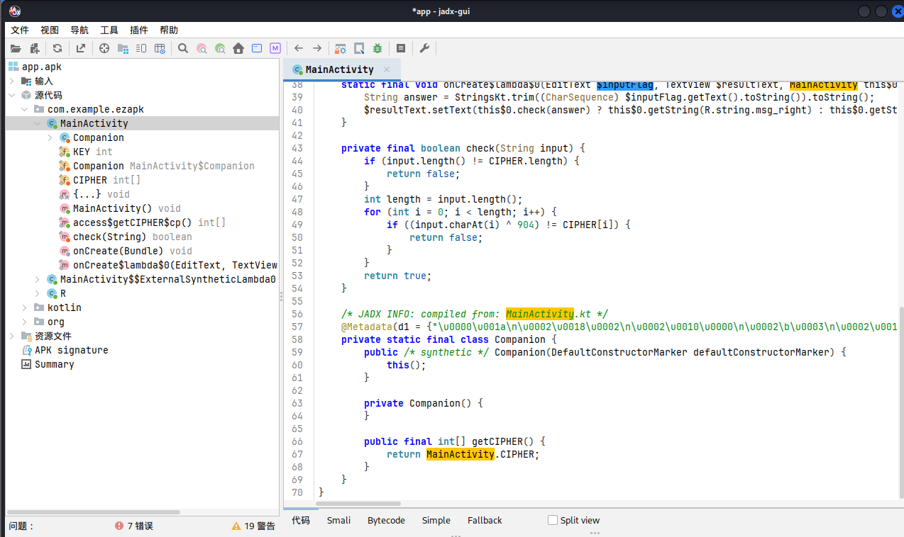

### ezAndroid

#### 一、思路

```
一个普通 APK
jadx 反编译，找到 MainActivity
check() 逻辑：input[i] XOR 904 == CIPHER[i]
反推 input[i] = CIPHER[i] XOR 904，纯静态即可
```

#### 二、分析

##### 2.1 jadx 反编译

```bash
jadx-gui app-debug.apk
```

定位到 `com.example.ezapk.MainActivity`
核心校验数组 CIPHER 和 check 方法



##### 2.2 校验逻辑

```kotlin
if (input.length != CIPHER.size) return false;
for (i in input.indices) {
    if ((input[i].code xor 904) != CIPHER[i]) return false;
}
```

密钥固定 904，反推

##### 2.3 解密脚本

```python
cipher = [1006,996,1001,1007,1011,994,1001,1004,1008,983,1018,955,
          1022,955,1018,1019,953,998,1007,983,997,956,1019,1020,
          955,1018,983,952,1018,983,956,998,1004,1018,952,953,1004,1013]
key = 904
print(''.join(chr(c ^ key) for c in cipher))
```

#### 三、最终 Flag

```
flag{jadx_r3v3rs1ng_m4st3r_0r_4ndr01d}
```

[解题脚本](附件/script/ezAndroid/solve.py)
