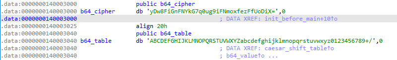

### justre

#### 一、思路

```
challenge.exe 是 console 64程序
strings 提取密文和函数名
IDA 反汇编 crypto 函数，发现每个字节 (input+9) ^ 0x12
init_before_main 启动时对 Base64 表做凯撒移位
用修改后的表解码密文，再反推加法和异或
```

#### 二、分析

##### 2.1 strings 提取

```
yDw8FiGnFNYkG7q0ug9iFNmoxfezFfUoDiX=
Please enter your answer:
the len is wrong!
Wrong!!
Great!!!
```

函数名：`init_before_main` `caesar_shift_table` `main`




##### 2.2 main函数

```
do
{
  v5 = v4[16];
  (++v4)[15] = (v5 + 9) ^ 0x12;
}
while ( v4 != (char *)&Str.m128i_u64[1] +2 );
```
这里将输入的字符串逐个进行加9，然后和12h进行异或

加密算法：每个字节 `(input + 9) ^ 0x12` 的结果和密文比较
从密文反推flag：`input = (密文 ^ 0x12) - 9`

##### 2.3 Base64 表被凯撒移位

`init_before_main` 启动时改 Base64 字母表

看caesar_shift_table可以得到运行时表
```c
// 大写 A-Z：+7
result = ((c - 58) % 26) + 65    //即 (c - 65 + 7) % 26 + 65
// 小写 a-z：-7
result = ((c - 78) % 26) + 97    //即 (c - 97 - 7) % 26 + 97
// 数字 0-9：+4
result = ((c - 44) % 10) + 48    //即 (c - 48 + 4) % 10 + 48
```
`HIJKLMNOPQRSTUVWXYZABCDEFGtuvwxyzabcdefghijklmnopqrs4567890123+/`


##### 2.4 解密

```python
import base64

ct = 'yDw8FiGnFNYkG7q0ug9iFNmoxfezFfUoDiX='
runtime = 'HIJKLMNOPQRSTUVWXYZABCDEFGtuvwxyzabcdefghijklmnopqrs4567890123+/'
std     = 'ABCDEFGHIJKLMNOPQRSTUVWXYZabcdefghijklmnopqrstuvwxyz0123456789+/'

# 运行时表映射回标准表，Base64 解码出 26 字节
data = base64.b64decode(ct.translate(str.maketrans(runtime, std)))

# 反推每个字节
flag = ''.join(chr(((b ^ 0x12) - 9) & 0xff) for b in data)
print(flag)
```

#### 三、最终 Flag

```
flag{simple_script_right?}
```

[解密脚本](附件/script/justre/decode.py)
