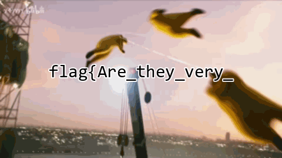
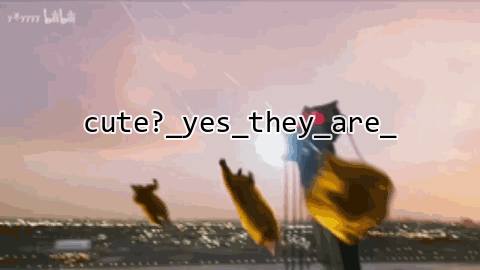
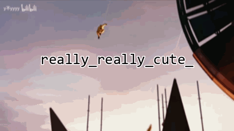
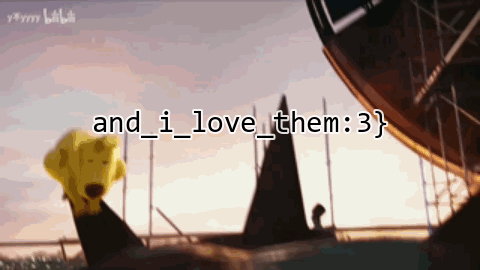

### three_kings

#### 一、解题思路

```
challenge.gif 是动图
用 GIF 拆帧工具导出全部帧
flag 被拆散藏在4帧里
按帧序拼接 4 段得到完整 flag
```

#### 二、分析过程

##### 2.1 GIF 拆帧

GIF 是多帧连续动画，flag 的几段文字分别画在不同帧上，连起来看才是完整内容
用 GIF 拆帧工具把所有帧导出成 PNG
逐帧浏览，在第 25、33、55 帧等处发现四段 flag 





4段进行拼接

#### 三、最终 Flag

```
flag{Are_they_very_cute?_yes_they_are_really_really_cute_and_i_love_them:3}
```
