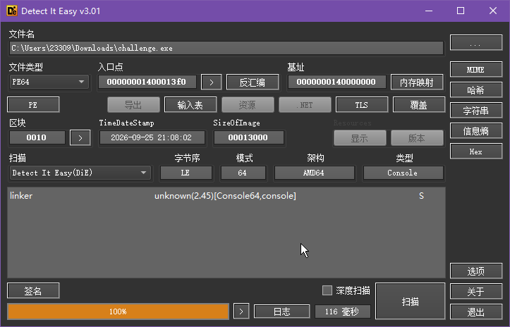
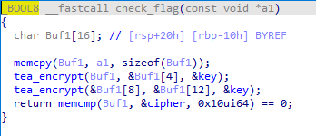

### 写题写累了喝一杯茶吧

#### 一、思路
```
DIE 查壳确认无壳
64 位控制台程序
IDA64 反编译 main 和 check_flag
识别 TEA 加密
从 .rdata 提取 cipher 和 key
TEA 解密得到 flag
```

#### 二、分析

##### 2.1 DIE 查壳

用 DIE 打开：无壳，64 位控制台程序



##### 2.2 main 函数

IDA64 反编译 main：

```c
printf("Input your flag: ");
scanf("%63s", Str);
if ( strlen(Str) == 16 ) {
    if ( check_flag(Str) )
        puts("[+] Correct! Here is your cup of tea ~");
    else
        puts("[-] Wrong flag, keep drinking and writing ~");
}
```

flag 长度固定 16 字节，核心校验在 `check_flag`

##### 2.3 check_flag 分析

反编译 `check_flag`

```c
char Buf1[16];
memcpy(Buf1, a1, 0x10u);
tea_encrypt(Buf1, &Buf1[16], &key);
tea_encrypt(&Buf1[8], &Buf1[16], &key);
return memcmp(Buf1, cipher, 0x10u) == 0;
```



把 16 字节 flag 分两组各 8 字节做 TEA 加密
结果和 `.rdata` 里的 cipher 比较
函数名 `tea_encrypt` + delta 段是标准 TEA 常数 `0x9E3779B9`

##### 2.4 提取密文与key

 `.rdata` 提取：

```
cipher（16 字节）:
89 73 95 16 2C E9 A7 B8 8E 14 BB D3 BA 54 3A E6
```

```
delta（4 字节，小端）:
B9 79 37 9E → 0x9E3779B9
```
```
key（16 字节，ASCII）:
74 65 61 74 69 6D 65 21 74 65 61 74 69 6D 65 21 → "teatime!teatime!"
```

##### 2.5 TEA 解密

程序是"加密的 flag 和 cipher 比较"
反过来解密 cipher 就是 flag

```python
import struct

def tea_dec(block, k):
    v0, v1 = struct.unpack('<II', block)
    s = 0xC6EF3720
    for _ in range(32):
        v1 = (v1 - (((v0 << 4) + k[2]) ^ (v0 + s) ^ ((v0 >> 5) + k[3]))) & 0xFFFFFFFF
        v0 = (v0 - (((v1 << 4) + k[0]) ^ (v1 + s) ^ ((v1 >> 5) + k[1]))) & 0xFFFFFFFF
        s = (s - 0x9e3779b9) & 0xFFFFFFFF
    return struct.pack('<II', v0, v1)

c = bytes([0x89,0x73,0x95,0x16,0x2C,0xE9,0xA7,0xB8,
           0x8E,0x14,0xBB,0xD3,0xBA,0x54,0x3A,0xE6])
k = struct.unpack('<IIII', b'teatime!teatime!')
print(tea_dec(c[:8], k) + tea_dec(c[8:], k))
```

#### 三、最终 Flag

```
flag{TEA_1s_ez!}
```