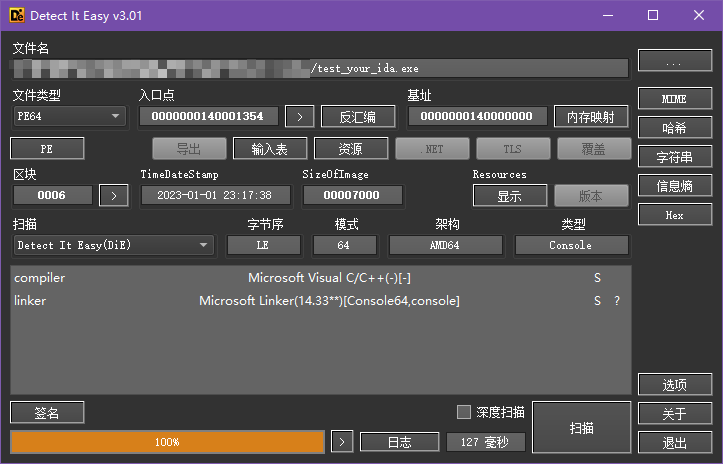
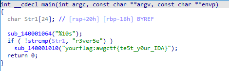

### 新人入门必看

#### 一、解题思路

```
DIE 查壳确认无壳
64 位控制台程序
IDA64 打开，主函数里就能看到 flag
```

#### 二、分析过程

##### 2.1 DIE 查壳

用 DIE 打开 `test_your_ida.exe`
无壳，64 位控制台程序



##### 2.2 IDA 找 flag

IDA64 打开，F5 反编译主函数
字符串里直接就是 flag



#### 三、最终 Flag

```
awgctf{te5t_y0ur_IDA}
```
